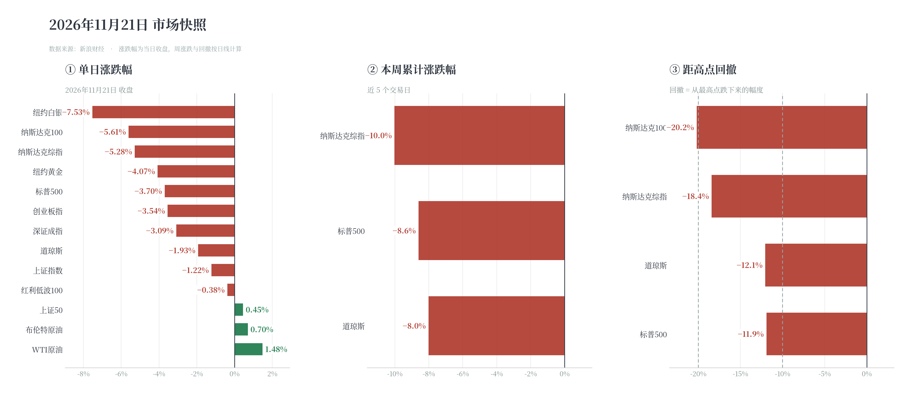

# 每日投资学习材料 · 第 1 期

**2026-11-21（周六）｜主题：一周里纳指跌超 10%、英伟达单日跌 14%，正好用来学会"回撤"和"净值滞后"这两件事**

> 你的关注清单：纳指 · 标普500 · 美股科技/AI · 红利低波100 · 黄金 ｜ 渠道：支付宝场外基金
> 阅读时间约 15 分钟

## 一、今天的行情快照

**三句话总结今天：**
1. 最近一个交易日美股出现剧烈下跌：纳斯达克综指单日 -5.28%、本周 -10.02%，标普500 单日 -3.70%、本周 -8.61%，纳指距 52 周高点已回落 18.41%、纳斯达克100 回落 20.19%。
2. 跌的不只是股票：纽约黄金单日 -4.07%、纽约白银单日 -7.53%，说明这一天的抛售是"连避险资产一起卖"的普跌，不是单纯的科技股回调。
3. A 股同日也走弱（创业板指 -3.54%、深证成指 -3.09%），但上证50 逆势 +0.45%、红利低波100 仅 -0.38%，防御类资产相对抗跌的特征在同一天里表现得很清楚。

> **一句话记住今天**：单日跌幅和"距高点回撤"是两个不同尺度的数字，混着看会让人做出错误决定。

## 二、今日价格表

**美股（最近一个交易日收盘）**

| 指数 | 收盘 | 单日 | 本周 | 距52周高点 |
|---|---|---|---|---|
| 纳斯达克综指 | 22,617.73 | -5.28% | -10.02% | -18.41% |
| 纳斯达克100 | 25,028.98 | -5.61% | — | -20.19% |
| 标普500 | 6,910.39 | -3.70% | -8.61% | -11.91% |
| 道琼斯 | 48,147.33 | -1.93% | -8.02% | -12.05% |

**贵金属与商品**

| 品种 | 最新 | 单日 | 本周 | 距高点 |
|---|---|---|---|---|
| 纽约黄金 | 3,535.39 | -4.07% | — | — |
| 纽约白银 | 41.50 | -7.53% | — | — |
| WTI原油 | 83.66 | +1.48% | — | — |
| 布伦特原油 | 92.63 | +0.70% | — | — |

**A股与红利低波100**

| 指数 | 收盘 | 单日 | 本周 |
|---|---|---|---|
| 上证指数 | 3,533.79 | -1.22% | — |
| 深证成指 | 10,256.39 | -3.09% | — |
| 创业板指 | 2,212.13 | -3.54% | — |
| 上证50 | 2,785.92 | +0.45% | — |
| 红利低波100（930955） | 11,878.27 | -0.38% | — |

（"—"表示本次数据未提供，不做估算。）

## 三、今天必须搞懂的一个概念

**回撤（Drawdown）：从高点往下掉了多少**

今天表格里有两个跌幅，很多人会看混：

- **单日跌幅**：只比较"昨天收盘"和"今天收盘"。纳指综指 -5.28% 就是这个。
- **距52周高点**：拿今天的收盘价，和过去一年最高点比。纳指综指 -18.41%、纳斯达克100 -20.19%，说的是这个。

**原理**：回撤是"从山顶往下量"，单日跌幅是"今天比昨天差多少"。前者告诉你现在站在山的哪个位置，后者只告诉你今天走了多陡的一步。一个指数可以单日只跌 1%，但距高点已经 -25%，这叫"阴跌"；也可以单日跌 5%，但距高点只有 -6%，那只是刚离开山顶。

**传导链条**：回撤变大 → 部分带"清盘线/止损线"的资金被迫减仓（今天快讯里就有机构提到"部分基金到清盘线只能被动减仓"）→ 被动卖出加大跌幅 → 回撤进一步变大。这就是为什么大跌往往不是一条平滑的线。

**直白解释**：单日跌幅是"今天摔了一跤"，回撤是"从最高处算，你已经滑下来多远了"。判断该不该慌，看的是后者，不是前者。

## 四、术语小词典

| 术语 | 大白话解释 | 今天为什么重要 |
|---|---|---|
| 纳斯达克综指 | 纳斯达克市场全部公司的总成绩单 | 今天 -5.28%，是全场最直观的"科技股温度计" |
| 纳斯达克100 | 纳斯达克里最大的 100 家非金融公司 | 距高点 -20.19%，比综指更深，说明大科技跌得更狠 |
| 标普500 | 美国 500 家大公司的总成绩单，比纳指更"全行业" | 今天 -3.70%，跌幅小于纳指，说明不是所有行业一样惨 |
| 距52周高点 | 现价比过去一年最高点低多少 | 这是判断"跌到什么位置"的尺子，不是"今天跌多少" |
| 回撤 | 从高点往下滑的幅度 | 今天最该学会的词，见第三节 |
| 费城半导体指数 | 美国芯片公司股价的合集指标 | 快讯提到它重挫近 11%，比大盘更猛，说明芯片是重灾区 |
| 清盘线 | 基金亏到某个比例就必须停掉/减仓的约定线 | 快讯里机构"被动减仓"就是被它逼的，解释了跌势为何加速 |
| 红利低波 | 分红高、股价波动小的那一类股票 | 今天 -0.38%，在普跌里明显抗跌，是"防御"的样本 |
| 避险资产 | 市场恐慌时大家以为会保值的资产（如黄金） | 今天黄金也 -4.07%，说明"避险"不是保险箱 |
| 场外基金 | 在支付宝这类平台申购、不通过股票账户买卖的基金 | 你的唯一渠道，它的净值更新有滞后，见第八节 |

## 五、新闻与政策解读

**1. 英伟达单日暴跌 14.01%，费城半导体指数重挫近 11%（快讯 11-21 15:27）**
- 事实：快讯称美股三大指数全线收跌，纳指 -5.28%，英伟达单日 -14.01%；有私募机构提到"部分基金到清盘线只能被动减仓"。
- 教学点：单只龙头股跌 14%，会通过"指数权重"放大成整个指数的跌幅。你买的纳指/科技类基金里，这类大权重股占比很高，所以"买指数"不等于"分散掉个股风险"。

**2. 特朗普再批美联储利率太高，称决策带"政治属性"（快讯 11-21 18:46）**
- 事实：快讯称特朗普 20 日再度批评美联储，认为利率过高，并称表态不是责怪美联储主席凯文·沃什；分析认为通胀高位使美联储不敢贸然降息。
- 教学点：利率是"钱的价格"。利率高，股票估值容易被压；市场对"降不降息"的预期一变，波动就放大。这条新闻本身不构成买卖依据，但解释了为什么市场对政策消息这么敏感。注意：快讯未提供当前具体利率数值，本材料不填。

**3. 华源证券：大型国有银行仍具红利价值（快讯 11-21 14:27）**
- 事实：快讯称三季报国有行业绩增速延续修复，中期分红比例进一步提升，强化红利属性。
- 教学点：这是"红利低波"这类资产的基本面逻辑——分红比例提升，意味着"现金回报"这条线更实。但机构观点是观点，不是承诺。

**4. 中信建投食品饮料 2027 年策略：红利守正、成长出奇（快讯 11-21 14:20）**
- 事实：快讯提出"大盘红利底仓 + 成长突围 + 周期反转"的哑铃结构选股思路。
- 教学点："哑铃结构"= 一头放稳的（红利），一头放弹的（成长），中间少放。这正好对应你今天清单里的两类资产：红利低波100 与纳指/科技。今天两者的单日表现（-0.38% vs -5.28%）就是这种搭配的直观演示。

## 六、市场情绪读数

| 指标 | 读数 | 怎么读 |
|---|---|---|
| 纳斯达克综指单日 | -5.28% | 单日跌超 5% 属于剧烈波动，不是日常小调整 |
| 费城半导体指数单日 | 近 -11%（快讯原文） | 板块跌幅约为大盘两倍，说明抛售集中在芯片/AI 硬件 |
| 纽约白银单日 | -7.53% | 白银波动通常大于黄金，今天跌幅也大于黄金的 -4.07% |
| 纽约黄金单日 | -4.07% | 连"避险"资产都大跌，说明当天是广泛抛售，而非单纯换仓 |
| 上证50 单日 | +0.45% | 同日 A 股大盘蓝筹逆势收红，防御属性显现 |
| VIX 恐慌指数 | 未获取 | 本次数据未提供，不做估算 |

## 七、K 线与趋势结构

先把位置摆清楚（全部来自上表）：

- 纳斯达克综指距 52 周高点 **-18.41%**，纳斯达克100 **-20.19%**——按常用的口语说法，这已经是"从高点回落两成"的深度区间。
- 标普500 距高点 **-11.91%**，道琼斯 **-12.05%**——同样在回撤，但幅度明显小于纳指，说明这轮下跌的"重心"在科技。
- 本周维度：纳指 -10.02%、标普 -8.61%、道指 -8.02%，一周内三大指数同步大跌，属于"系统性"而非"个别板块"的周线。
- 红利低波100 今天只 -0.38%，是清单里最抗跌的一项（本周数据未提供）。

**认知要点**：均线（比如常用的 60 日、200 日均线）是**事后确认工具**，不是预测工具。价格先跌，均线后走下来；等均线"确认走坏"，跌幅往往已经发生了一大半。所以看均线的正确用法是"描述现在处于什么状态"，而不是"用它算出明天会怎样"。今天这种单日 -5% 的行情，任何均线都来不及反应，这正是它不适合做短线开关的原因。

## 八、场外基金实操课

**今天讲：净值滞后——为什么周一你看到的"跌"，可能还没跌完**

场外基金（支付宝上买的这类）和股票不一样：你下单时不知道成交价。

1. **下单按"未知价"**：你在交易日的申购/赎回，成交价是**当天收盘后算出来的净值**，你下单那一刻并不知道是多少。
2. **净值公布有延迟**：QDII 类基金（投美股、黄金的）因为要等海外市场收盘、再折算汇率，净值通常比 A 股基金更晚公布，且**周末不更新**。今天是周六，你看到的净值大概率还是最近一个交易日的。
3. **这意味着什么**：本周美股跌了这么多，如果你持有的美股/黄金类场外基金净值还没完全体现，**不要以为"没跌"**。它只是还没算到你账上。
4. **实操含义**：
   - 别在"看到大跌"的当天冲动加仓或割肉——你交易的价格还没定。
   - 赎回时注意：QDII 到账通常比 A 股基金慢，急用钱要提前算好时间。
   - 周末看到的净值是"旧账"，判断要基于"最近一个交易日收盘"这个事实，而不是"我的持仓页面今天没变"。

（汇率折算、A/C 类费用差异，后面几期单独讲。）

## 九、投资建议（教学示例，非个性化建议）

**你必须自己回答的三个问题：**
1. 这笔钱多久不用？如果是 1 年内要用的钱，本周这种波动你扛不扛得住？
2. 你清单里五类资产，现在是"全都持有"还是"只持有一两类"？全押科技的话，本周 -10% 是完整体验。
3. 如果下周再跌 5%，你的动作是"加、减、还是不动"？现在先想好，别等跌了再想。

**分层参考框架（教学示例，不是给你的配置建议）**

| 层次 | 对应你清单里的 | 这一周教给我们的事 |
|---|---|---|
| 进攻层 | 纳指、标普500、美股科技/AI | 弹性大、回撤也大，本周 -8% 到 -10% 是它的常态区间之一 |
| 防御层 | 红利低波100 | 同日 -0.38%，跌得少，作用是"降低整体晃动" |
| 另类/避险层 | 黄金 | 今天 -4.07%，提醒"避险"不等于"不跌" |
| 现金/货基 | （清单外，但常被忽略） | 手上有余钱，大跌时才有选择权 |

**这周不要做的事：**
- 不要因为"跌了很多"就认为"到底了"——本材料不预测点位。
- 不要在同一天里既看单日跌幅又看回撤，然后得出矛盾结论。
- 不要用"我的基金页面今天没跌"来判断市场，那是净值滞后。
- 不要看着快讯里某机构的持仓动作（清仓/减持/死守）就跟着做，那是别人的钱和别人的约束条件。

## 十、今日作业

1. **算一遍自己的回撤**：打开支付宝，找出你持有的美股/科技类基金，看它最近一个交易日的净值涨跌，和表格里纳指 -5.28% 对比，感受"滞后"有多大。
2. **写一句话区分**：用你自己的话写下"单日跌幅"和"距52周高点"的区别，不超过 30 字。
3. **对照一次防御**：把红利低波100 今天 -0.38% 和纳指 -5.28% 并排写在纸上，问自己：如果重来一次，我希望这两类各占多少？（只写想法，不下单。）

## 十一、明日预告

下一期讲：**汇率怎么悄悄影响你买的美股/黄金基金**——同样的美股跌幅，人民币计价和美元计价可能不是一回事。

## 数据来源

- 结构化行情数据（美股指数、贵金属与商品、A 股指数、红利低波100，最近一个交易日收盘）
- 新浪财经 7×24 快讯（2026-11-21，原文未核实）

> **免责声明**：本文为投资知识学习材料，不构成任何投资建议。市场有风险，决策请独立判断。
