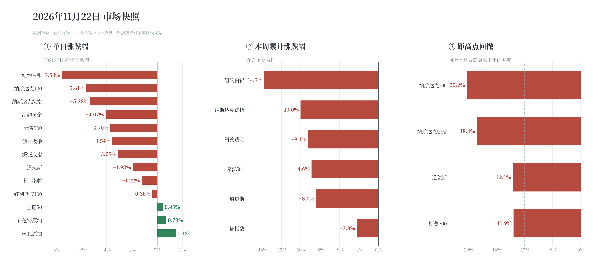

# 每日投资学习材料 · 第 2 期

**2026-11-22（周日）｜主题：一周里纳指跌超 10%、黄金跌超 9%——"股金同跌"时，先学会看回撤，再谈要不要动手**

> 你的关注清单：纳指 · 标普500 · 美股科技/AI · 红利低波100 · 黄金 ｜ 渠道：支付宝场外基金
> 阅读时间约 15 分钟

## 一、今天的行情快照

**三句话总结今天：**
1. 今天是周日，市场休市，下面所有价格都是**最近一个交易日**的收盘数据，不是今天的实时价。
2. 本周是普跌的一周：纳斯达克综指本周 -10.02%、标普500 本周 -8.61%、纽约黄金本周 -9.06%，连避险资产黄金也一起跌，这是本周最值得注意的地方。
3. 快讯层面，压制市场的主线是"美联储加息预期升温"（美联储理事库克 20 日称迫切需要加息压低通胀），叠加中金研报提到的"全球 AI 相关负面叙事边际明显增加"。

> **一句话记住今天**：跌得多不等于便宜，先看"距高点回撤了多少"，再看"跌的原因有没有变"。

## 二、今日价格表

**美股（最近一个交易日收盘）**

| 指数 | 收盘 | 单日 | 本周 | 距52周高点 |
|---|---|---|---|---|
| 纳斯达克综指 | 22,617.73 | -5.28% | -10.02% | -18.41% |
| 纳斯达克100 | 25,028.98 | -5.61% | — | -20.19% |
| 标普500 | 6,910.39 | -3.70% | -8.61% | -11.91% |
| 道琼斯 | 48,147.33 | -1.93% | -8.02% | -12.05% |

**贵金属与商品**

| 品种 | 最新 | 单日 | 本周 | 距高点 |
|---|---|---|---|---|
| 纽约黄金 | 3,535.39 | -4.07% | -9.06% | — |
| 纽约白银 | 41.50 | -7.53% | -14.70% | — |
| WTI原油 | 83.66 | 1.48% | — | — |
| 布伦特原油 | 92.63 | 0.70% | — | — |

**A股与红利低波100**

| 指数 | 收盘 | 单日 | 本周 |
|---|---|---|---|
| 上证指数 | 3,533.79 | -1.22% | -2.77% |
| 深证成指 | 10,256.39 | -3.09% | — |
| 创业板指 | 2,212.13 | -3.54% | — |
| 上证50 | 2,785.92 | 0.45% | — |
| 红利低波100（930955） | 11,878.27 | -0.38% | — |

注：表中"—"表示我这边没有获取到该字段数据，不做估算。

## 三、今天必须搞懂的一个概念

**回撤（Drawdown）——本周最该先看懂的一个数**

看价格表最后一列"距52周高点"：纳斯达克100 是 -20.19%，纳斯达克综指 -18.41%，标普500 -11.91%。这个百分比就是**回撤**：从过去一年最高点跌到现在，一共跌掉了多少。

**原理**：回撤衡量的是"从山顶往下走了多远"，它和"今天跌了多少"是两件事。单日跌幅告诉你情绪有多急，回撤告诉你位置有多低。两者要分开看。

**传导链条**：加息预期升温 → 市场要求更高的回报率才肯持有风险资产 → 高估值资产（成长股、科技股）先被压 → 指数从高点回落 → 回撤数字变大。这条链条里，回撤是**结果**，不是原因。

**一个必须提醒的换算陷阱**：跌 20% 之后，要涨回去不是 20%，而是约 25%（1÷0.8-1）。跌得越深，回本需要的涨幅越大——这就是为什么"回撤"比"跌幅"更值得盯。

**直白解释**：回撤就是"你现在站在半山腰的哪个位置"，它告诉你离山顶多远，但不告诉你山脚在哪，更不告诉你明天会不会继续往下走。

## 四、术语小词典

| 术语 | 大白话解释 | 今天为什么重要 |
|---|---|---|
| 回撤 | 从最高点跌到现在，跌掉了百分之多少 | 表里"距52周高点"一列就是它 |
| 52周高点 | 过去一年里出现过的最高价 | 回撤的参照物，没有它就算不出回撤 |
| 加息 | 央行把借钱的利息调高，钱变贵了 | 本周快讯里市场下跌的主线原因 |
| 避险资产 | 大家害怕时习惯性去买的东西，黄金常被这么归类 | 本周黄金也跌了 9.06%，说明"避险"不是保险 |
| 场外基金 | 在支付宝这类平台申购、不通过股票账户买卖的基金 | 你的唯一渠道，净值一天只更新一次 |
| 净值 | 一只基金一份值多少钱，通常每天收盘后算一次 | 场外基金按净值成交，不是按盘中价 |
| 指数基金 | 照着某个指数（如纳指100）的成分股去买的一篮子基金 | 你买"纳指"实际买的是跟踪它的基金 |
| 红利低波 | 挑分红高、波动相对小的股票组成的一类指数 | 本周它单日只跌 0.38%，比科技类温和得多 |
| 牛市回调 | 上涨大趋势中的一段下跌，机构认为不等于趋势反转 | 快讯里多家华尔街机构的说法，属观点非事实 |
| 情绪驱动 | 涨跌主要由恐慌或乐观推动，而非基本面变化 | 快讯中 E*Trade 拉金的表述，需自行判断 |

## 五、新闻与政策解读

**1）美联储加息预期升温（11-22 12:19 快讯）**
事实：美联储理事丽莎·库克 20 日表示，美联储迫切需要加息以压低通胀，并警告延迟行动可能要以更快速度加息至更高水平；美银策略师 Hartnett 称，阻止加息最快的方式是让美股回吐 2026 年全部涨幅，对应标普500 6845 点，而该指数上周五收于 6910 点。
教学点：注意区分"官员表态"和"已落地的政策"——表态会影响预期，预期会先反映在价格里，但表态不等于加息已经发生。另外，机构给出的具体点位是**他们的测算**，不是承诺，别当成目标价。

**2）AI 叙事出现负面边际（11-22 08:31 中金研报）**
事实：中金指出近期市场不佳源于外部冲击，包括美联储加息预期升温、全球 AI 相关负面叙事边际明显增加（提到英伟达管理层变动、美国算力管制延伸至远程访问），以及全球主要股市波动影响 A 股。
教学点：这段话把"跌的原因"拆成了三层。对新手最有用的动作是：把原因列出来，然后逐条问"这条是暂时的还是结构性的"。想不清楚的，就先不动。

**3）英伟达相关调查（11-22 01:15、01:11 快讯）**
事实：加州总检察长邦塔称，针对英伟达芯片销售及是否误导投资者的调查，同时在核查是否存在州法下的刑事违规；调查处于初步阶段，尚未形成任何结论。
教学点："初步阶段、尚无结论"是这条新闻最重要的六个字。同一件事在"启动调查"和"认定违规"两个阶段，对资产的影响量级完全不同。

**4）多家机构认为可能是牛市回调（11-22 07:26 快讯）**
事实：摩根士丹利旗下 E*Trade 的拉金表示，考虑到经济和基本面背景依然稳健，这轮行情似乎主要由市场情绪驱动；并称自 1983 年以来标普500 从高点跌入回调区间的 15 次行情中，只有 5 次最终演变为熊市。
教学点：这是**观点**，不是数据结论。而且"15 次里 5 次变熊"意味着有三分之一的情况没被说成"只是回调"——读这类统计，要同时看分子和分母。

**5）亚马逊接近收购 AI 初创 Decart（11-22 01:33 快讯）**
事实：交易金额 75 亿美元，谈判进入后期，最早可能下周初敲定，仍存在破裂可能；Decart 的核心软件能提升 AI 模型运行效率、释放芯片算力。
教学点：AI 领域的钱没有停，只是从"买芯片"往"提效率"扩散。这对判断"AI 叙事是否终结"是一个反向证据，但单笔交易不构成趋势判断。

## 六、市场情绪读数

| 指标 | 读数 | 怎么读 |
|---|---|---|
| 纳斯达克综指单日 | -5.28% | 单日跌超 5%，属于情绪集中释放的级别，不是日常波动 |
| 纳斯达克100 距高点 | -20.19% | 已进入通常所说的"技术性回调"深度区间，位置偏低 |
| 纽约白银本周 | -14.70% | 跌幅约为黄金的 1.6 倍，白银波动天然大于黄金 |
| 纽约黄金本周 | -9.06% | 传统"避险资产"同步大跌，说明本轮抛售不分品类 |
| 上证50 单日 | +0.45% | A 股大盘权重当日逆势收红，与深证成指 -3.09% 形成分化 |
| 红利低波100 单日 | -0.38% | 跌幅远小于科技类，体现"低波"特征 |
| VIX（恐慌指数） | 未获取 | 我这边没有该数据，不做推测 |

## 七、K 线与趋势结构

先把位置说清楚，只说我有的数：

- **纳斯达克100**：距 52 周高点 -20.19%，是关注清单里回撤最深的一个。
- **纳斯达克综指**：距高点 -18.41%，本周 -10.02%。
- **标普500**：距高点 -11.91%，本周 -8.61%，回撤明显小于纳指——因为它的成分更分散。
- **道琼斯**：距高点 -12.05%，本周 -8.02%。
- **红利低波100**：距高点数据未获取，只知单日 -0.38%，是表里最抗跌的一项。

**这里要建立一个认知**：均线（比如 60 日均线、120 日均线）是**事后确认工具**，不是预测工具。价格先动，均线后动。当指数已经跌破某条均线时，均线只是把"已经发生的事"画成一条线，它不会告诉你底在哪。所以看趋势结构，正确的顺序是：先看回撤位置 → 再看跌的原因是否变化 → 最后才用均线做辅助描述。反过来用（先看均线猜涨跌）是新手最常见的误区。

另外，本周只有 2 天历史积累数据（见原始 JSON 中"历史积累天数"多为 2），**不足以画出有意义的 K 线形态**。这一点必须诚实说明：形态分析需要足够长的数据序列，现在还不具备。

## 八、场外基金实操课

**今天讲：净值滞后——为什么周一你看到的"跌了 10%"，不一定是你能成交的价格**

场外基金和股票最大的区别：股票盘中随时成交，价格一秒一变；场外基金**一天只有一个净值**，通常在每个交易日收盘后计算并公布。

这带来两个具体后果，本周特别值得注意：

**第一，你下单时看到的是"昨天的净值"。** 假设你在周一（11-23）下午 3 点前提交申购，成交价用的是周一收盘后算出的净值，而不是你点"买入"那一刻屏幕上显示的、上周五的净值。上周五纳指跌 5.28%、本周累计跌 10.02%，这些已经发生的跌幅，会体现在你实际成交的净值里——但具体是多少，要等基金公司公布才知道，我这边**未获取**相关净值数据。

**第二，QDII 类基金（投美股的那类）还多一层时间差。** 美股在北京时间夜里交易，所以投美股的场外基金，净值通常要滞后一到两天才反映出来。这意味着：当你看到"A 股白天大跌"想赎回美股基金时，你卖掉的其实是还没反映最新美股行情的那个净值。

**给你的操作原则（不是建议，是认知）**：
- 场外基金不适合做"看盘即交易"的动作，它的机制天生慢半拍。
- 想减少"买在滞后净值上"的不确定感，就不要在剧烈波动日临时起意下单，把决策放在情绪平稳的时候做。
- 具体某只基金是 T+1 还是 T+2 确认、有没有限购，**必须以支付宝页面上该基金的实时公告为准**，我这边没有这些数据。

## 九、投资建议（教学示例，非个性化建议）

**你必须自己回答的三个问题：**

1. 你买这些钱的**用途和期限**是什么？三年内要用的钱，和十年不用的钱，面对 -20% 回撤该有的反应完全不同。
2. 如果下周再跌 10%，你的**动作**是什么？现在答不出来，说明仓位超过了你的承受力。
3. 你买的是**什么**？"纳指基金"和"标普500基金"和"红利低波基金"，跌的时候跌幅差一倍以上，你清楚自己持有的是哪一类吗？

**分层参考框架（教学示例，非建议）**

| 层次 | 特征 | 本周对应的观察 |
|---|---|---|
| 保守层 | 波动小、以稳为主 | 红利低波100 单日 -0.38%，是清单里最抗跌的 |
| 核心层 | 分散度较高、覆盖面广 | 标普500 回撤 -11.91%，小于纳指 |
| 进攻层 | 集中度高、弹性大 | 纳斯达克100 回撤 -20.19%，跌得深也意味着波动大 |
| 另类层 | 与股票相关性不稳定 | 黄金本周 -9.06%，本周并未起到"对冲"作用 |

这张表想说明的只有一件事：**层次不是按"哪个会涨"排的，是按"跌的时候你能拿得住"排的。**

**这周不要做的事：**
- 不要因为"跌了 20% 就是便宜"就一次性重仓——回撤不构成买入理由，它只是描述位置。
- 不要在同一天既看美股暴跌新闻又临时决定加仓，情绪高点的决策质量最差。
- 不要把"机构说是牛市回调"当成事实，那是观点，且快讯里也提到 15 次中有 5 次演变为熊市。
- 不要用"黄金是避险资产"当作黄金不会大跌的理由，本周它跌了 9.06%。
- 不要在没搞清 A 类/C 类费率、申赎确认时间之前下单。

## 十、今日作业

1. **算一道回本题**：纳斯达克100 现在距高点 -20.19%。请算出它要涨回高点需要多少涨幅（提示：1÷(1-0.2019)-1）。算完写一句你的感受。
2. **查一只你持有的基金**：打开支付宝，找到你关注的美股相关基金，记录三件事——它是 A 类还是 C 类、申购确认是 T+几、当前有没有限购公告。这三项我这边都没有数据，必须你自己查。
3. **写一句"下跌预案"**：用不超过 30 个字写下"如果下周我的持仓再跌 10%，我会______"。写不出来也算一种答案，说明仓位需要调整。

## 十一、明日预告

下一期讲：**A 类还是 C 类？——场外基金那笔"看不见的成本"到底怎么算**，用你手上真实的持有期限来算一笔账。

## 数据来源

- 结构化行情数据（美股指数、贵金属与商品、A 股指数、红利低波100），由你提供的 JSON 与表格
- 新浪财经 7×24 快讯（2026-11-22，原文，未核实）
- 说明：VIX、各基金净值、限购与费率信息均**未获取**，文中未做任何估算

> **免责声明**：本文为投资知识学习材料，不构成任何投资建议。市场有风险，决策请独立判断。
