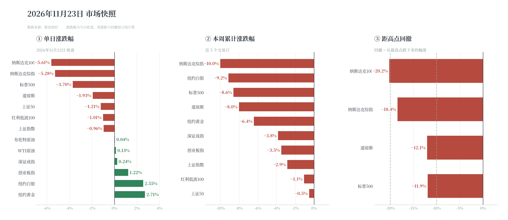

# 每日投资学习材料 · 第 3 期

**2026-11-23（周一）｜主题：美股一周跌掉两位数，先学会分清“价格跌了”和“逻辑变了”**

> 你的关注清单：纳指 · 标普500 · 美股科技/AI · 红利低波100 · 黄金 ｜ 渠道：支付宝场外基金
> 阅读时间约 15 分钟

## 一、今天的行情快照

**三句话总结今天：**
1. 美股上周跌得很重：纳斯达克综指单日 -5.28%、本周 -10.02%，标普500 单日 -3.70%、本周 -8.61%，纳指100 距52周高点已 -20.19%——按常见说法，这已经进入“技术性回调”甚至更深的位置。
2. 黄金上周先被砸（本周 -6.43%），今天出现反弹：纽约黄金单日 +2.71%，快讯提到现货黄金一度涨 2.6% 突破每盎司 3,630 美元，原因是逢低买盘入场、市场降低了对美联储 12 月加息的押注。
3. A 股与红利方向相对抗跌：上证 -0.96%、红利低波100 -1.01%，创业板指反而 +1.22%；但注意，红利低波100 本周也是 -1.07%，“抗跌”不等于“不跌”。

> **一句话记住今天**：大跌日最该做的不是猜底，而是把“我买的东西跌了多少、为什么跌、我当初为什么买”这三件事对齐。

## 二、今日价格表

**美股（最近一个交易日收盘）**

| 指数 | 收盘 | 单日 | 本周 | 距52周高点 |
|---|---|---|---|---|
| 纳斯达克综指 | 22,617.73 | -5.28% | -10.02% | -18.41% |
| 纳斯达克100 | 25,028.98 | -5.61% | — | -20.19% |
| 标普500 | 6,910.39 | -3.70% | -8.61% | -11.91% |
| 道琼斯 | 48,147.33 | -1.93% | -8.02% | -12.05% |

**贵金属与商品**

| 品种 | 最新 | 单日 | 本周 | 距高点 |
|---|---|---|---|---|
| 纽约黄金 | 3,610.76 | +2.71% | -6.43% | — |
| 纽约白银 | 42.62 | +2.55% | -9.15% | — |
| WTI原油 | 83.52 | +0.13% | — | — |
| 布伦特原油 | 92.61 | +0.04% | — | — |

**A股与红利低波100**

| 指数 | 收盘 | 单日 | 本周 |
|---|---|---|---|
| 上证指数 | 3,499.91 | -0.96% | -2.85% |
| 深证成指 | 10,280.58 | +0.24% | -3.84% |
| 创业板指 | 2,239.11 | +1.22% | -3.49% |
| 上证50 | 2,752.19 | -1.21% | -0.52% |
| 红利低波100（930955） | 11,757.94 | -1.01% | -1.07% |

> 说明：表中“—”表示我今日未获取到该字段数据，不做估算。

## 三、今天必须搞懂的一个概念

**概念：技术性回调（以及它和“熊市”的区别）**

今天材料里出现了“距52周高点 -20.19%”这样的数字。市场上有个常见说法：从高点回落 10% 叫“回调”，回落 20% 叫“进入熊市”。这只是**约定俗成的说法**，不是物理定律，也不是买卖信号。

**原理**：回撤（从高点跌下来的幅度）衡量的是“价格位置”，不是“公司好坏”。它只回答一个问题——现在的价格比之前的高点便宜了多少；它不回答“还会不会跌”“值不值得买”。

**传导链条**：价格下跌 → 新闻标题变吓人 → 投资者情绪变差 → 赎回/卖出 → 价格可能继续跌。这个链条里，情绪是放大器，不是原因。真正的原因要看盈利、利率、资金面。

**直白解释**：回撤就像体温计，告诉你现在烧到几度；但它不告诉你得的是什么病，更不告诉你明天会不会退烧。看到 -20% 就冲进去，和看到 -20% 就吓跑，本质是同一种错误——把温度计当医生。

## 四、术语小词典

| 术语 | 大白话解释 | 今天为什么重要 |
|---|---|---|
| 技术性回调 | 从高点跌 10% 左右的市场俗称，只是描述跌幅，不是买卖信号 | 标普500 距高点 -11.91%，正落在这个区间 |
| 回撤 | 现价距离之前最高点还差多少 | 纳指100 距高点 -20.19%，是今天最刺眼的数字 |
| 单日涨跌幅 | 一个交易日内涨了或跌了百分之几 | 纳指单日 -5.28%，属于剧烈波动 |
| 超卖（RSI 跌破30） | 一种技术指标，意思是“短期跌得太急”，不代表一定反弹 | 快讯提到黄金 14 天 RSI 跌破 30 |
| 逢低买盘 | 看到价格跌了就去买的力量 | 快讯说黄金反弹就是逢低买盘推动 |
| 加息／降息预期 | 市场对央行利率动作的押注，会影响全球资金流向 | 快讯称交易员对 12 月加息的押注下降 |
| 技术性回调区间 | 新闻里对标普、道指“跌超10%”的表述 | 快讯明确提到两大指数步入该区间 |
| 场外基金净值 | 你买的支付宝基金每天只公布一个收盘后的价格 | 美股大跌当天，你的基金净值要等次日才体现 |
| 红利低波 | 选高分红、波动相对小的股票组成的指数 | 今天 -1.01%，比纳指温和得多 |
| 股指期货 | 对未来指数价格的合约，常在盘前反映情绪 | 快讯提到标普500期货站上7100点、纳指100期货涨3.15% |

## 五、新闻与政策解读

**1）黄金反弹：逢低买盘入场，上周曾创 3 月以来最差单周表现**
- 事实：快讯称现货黄金一度上涨 2.6%、突破每盎司 3,630 美元，此前上周下跌 9%；市场降低了对美联储 12 月加息的押注，14 天 RSI 跌破 30。
- 教学点：黄金和股票常常“不同步”，这正是它在组合里的作用。但注意——黄金本周仍 -6.43%，“反弹一天”不等于“转势”，别用单日涨幅推翻一周的跌幅。

**2）马斯克警告：AI 行业明年或面临数千亿美元资金短缺**
- 事实：快讯称马斯克 11 月 22 日发文警告，若算力基础设施从付款到产生收入之间出现延误，全行业可能需要额外数千亿美元营运资金。
- 教学点：这是“AI 叙事”里第一次被公开摆上台面的**资金链问题**。你持有的美股科技/AI 基金，涨的是“未来预期”，一旦市场开始算“钱从哪来”，估值就会被重新审视。这不是让你卖，是让你知道自己在承担什么。

**3）高盛下调三星、SK海力士目标价**
- 事实：快讯称高盛认为 AI 算力需求继续支撑 2027 年存储芯片供不应求，但 2028 年供需趋于缓和，下调两家公司目标价。
- 教学点：同一份报告里既有“看好 2027”也有“看淡 2028”——专业机构看的从来不是一句话结论，而是**时间维度**。你买基金也要问自己：我打算拿多久？

**4）美联储观察：12 月加息概率不再是 100%**
- 事实：快讯称利率期货交易员最新定价下月加息 25 个基点概率约 95.2%、按兵不动概率 4.8%，一周前是百分百定价加息。
- 教学点：这就是“预期”的边际变化。市场跌，往往不是因为事情变坏，而是因为“原本以为的坏”稍微没那么坏了，或者反过来。学会读“概率变化”，比读“结论”有用。

**5）A股：融资保证金比例下限从 100% 降至 80%，11月30日起实施**
- 事实：快讯称沪深北交易所 11 月 22 日发布通知，广发证券测算预计带来近 4000 亿元增量资金；同日深交所就创业板做市细则征求意见。
- 教学点：这是“交易端”的政策，影响的是资金能不能更方便地进场。对红利低波这类偏稳健的方向，政策更多是“托底情绪”，不是“直接拉升”。

## 六、市场情绪读数

| 指标 | 读数 | 怎么读 |
|---|---|---|
| 纳斯达克综指单日 | -5.28% | 单日跌超 5% 属于恐慌级波动，说明卖出是集中发生的 |
| 纳斯达克综指本周 | -10.02% | 一周跌掉一成，情绪已从“调整”转向“避险” |
| 标普500 距52周高点 | -11.91% | 新闻称已步入技术性回调区间 |
| 纳指100 距52周高点 | -20.19% | 按常见说法已到“熊市”门槛附近，但这是描述不是判断 |
| 纽约黄金单日 | +2.71% | 避险与逢低买盘同时出现，与股市方向相反 |
| 黄金 14 天 RSI | 跌破 30（快讯原文） | 技术上是“超卖”，只说明跌得急，不保证反弹 |
| 12月加息概率 | 约 95.2%（一周前为100%） | 预期略微松动，是情绪修复的苗头，不是转向确认 |
| 美股期货（快讯） | 标普500期货站上7100点、纳指100期货涨3.15% | 盘前情绪回暖，但期货不等于收盘 |

> 说明：我今日未获取到 VIX 指数读数，故不列。

## 七、K 线与趋势结构

先把位置摆清楚（全部来自今日数据）：

- **纳斯达克综指**：现价 22,617.73，本周 -10.02%，距高点 -18.41%。这是“高位回落、跌幅加速”的结构。
- **纳斯达克100**：距高点 -20.19%，是四个美股指数里回撤最深的，说明科技权重越集中，跌得越狠。
- **标普500**：距高点 -11.91%，跌幅小于纳指，说明成分更分散确实能缓冲。
- **道琼斯**：单日 -1.93%，明显小于纳指 -5.28%，传统行业权重高，今天体现出了“分散”的价值。
- **红利低波100**：本周 -1.07%，是今天所有数据里跌幅最小的方向之一。
- **黄金**：本周 -6.43% 但单日 +2.71%，属于“急跌后反抽”，趋势是否修复，一天看不出来。

**认知要点**：均线、支撑位这些工具，本质是**事后确认**——它们帮你描述“已经发生了什么”，不能提前告诉你“接下来会怎样”。今天纳指跌破关键位置，均线只会告诉你“趋势转弱已确认”，不会告诉你底在哪。所以看 K 线的正确姿势是：用它管理自己的预期和仓位节奏，而不是用它下注。

## 八、场外基金实操课

**今天讲：净值滞后——为什么美股暴跌，你的基金今天可能“没怎么跌”**

场外基金（支付宝上买的那种）每天只成交一次：你在 15:00 前提交，按**当天收盘后算出的净值**成交。而投资美股的 QDII 基金更特殊——它跟踪的是美股**前一个晚上**的收盘，净值公布还要再晚一天左右。

**直白解释**：你今天早上看到纳指 -5.28%，那是“昨夜”的事；你手上那只美股基金，今天显示的净值可能还是“前夜”的价格，明天的净值才会把这次大跌算进去。所以会出现一种错觉：股票大跌，我的基金好像没事——**不是没事，是还没到账**。

**这对你意味着三件事**：
1. 别用“今天基金没跌”来安慰自己，也别用“今天基金没跌”来判断该不该加仓，你看到的可能是过期的价格。
2. 大跌当天 15:00 前买入，成交价是“今天收盘的净值”，而今天收盘对应的可能是**还没跌完的海外市场**——你买的不是“昨天的低点”。
3. 正因为有滞后，**分批买**比“一把梭”更适合场外美股基金：你无法精准踩点，那就用时间摊平。

## 九、投资建议（教学示例，非个性化建议）

**你必须自己回答的三个问题：**
1. 我这笔钱，多久之内不会用到？（少于 1 年的钱，不适合放在波动 -20% 的资产里）
2. 我买美股科技/AI 基金，是因为“看好长期”，还是因为“它之前涨得好”？
3. 如果明天再跌 5%，我会做什么？如果答不上来，说明仓位超过了你的承受力。

**分层参考框架（教学示例，非建议）**

| 你的情况 | 可以思考的方向 | 需要警惕的 |
|---|---|---|
| 刚入门、金额小 | 先用小额定投熟悉净值节奏和波动感受 | 别因为“跌了很多”就一次性重仓 |
| 已有美股科技仓位 | 检查它占你总资产的比例是否过高 | 纳指100 已 -20.19%，集中度风险已暴露 |
| 想要稳一点 | 红利低波100 今天 -1.01%，体现的是“相对抗跌” | 它本周也 -1.07%，“低波”不是“保本” |
| 想配黄金 | 理解它是“对冲工具”，不是“进攻工具” | 黄金本周 -6.43%，单日反弹不代表趋势反转 |

**这周不要做的事：**
- 不要因为“跌了 20% 很便宜”就一次性重仓，回撤没有下限承诺。
- 不要在同一天把黄金和美股科技同时加满——它们今天方向相反，但你未必承受得住两边同时波动。
- 不要用“新闻说要反弹”作为买入理由，快讯里的期货上涨不等于收盘上涨。
- 不要频繁看净值，场外基金一天一个价，看得越勤，越容易做错决定。

> 以上全部为教学示例，不构成任何个性化投资建议。

## 十、今日作业

1. **算一笔账**：打开支付宝，查一下你持有的（或想买的）美股基金，看它最近一次公布的净值日期是哪天，和今天纳指 -5.28% 对得上吗？写下你观察到的“滞后了几天”。
2. **做一次回撤体检**：把你关注清单里五个方向今天的“距高点”数字抄一遍（纳指 -18.41%、纳指100 -20.19%、标普500 -11.91%、红利低波100 无数据、黄金无数据），标出哪个最让你睡不着——那个就是你要减配或想清楚的方向。
3. **读一条新闻原文**：把马斯克那条 AI 资金短缺的快讯完整读一遍，用一句话写下“如果这个警告成真，对我持有的 AI 基金意味着什么”。

## 十一、明日预告

下一期讲：**“定投在大跌里到底有没有用”——用今天的回撤数字，算一遍不同买入节奏的结果差异。**

## 数据来源

- 结构化行情数据（美股指数、贵金属与商品、A股指数、红利低波100）：用户提供的当日行情 JSON
- 新闻快讯：新浪财经 7×24 快讯（2026-11-23，原文，未核实）

> **免责声明**：本文为投资知识学习材料，不构成任何投资建议。市场有风险，决策请独立判断。
