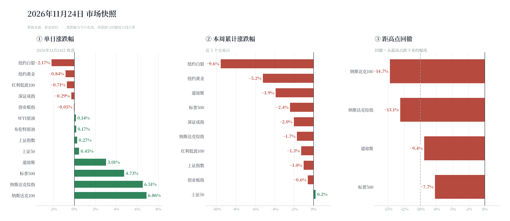

# 每日投资学习材料 · 第 4 期

**2026-11-24（周二）｜主题：一根“人事消息”能拉动全球科技股 6%，但你买的场外基金今天看不到这个价**

> 你的关注清单：纳指 · 标普500 · 美股科技/AI · 红利低波100 · 黄金 ｜ 渠道：支付宝场外基金
> 阅读时间约 15 分钟

## 一、今天的行情快照

**三句话总结今天：**
1. 美股最近一个交易日出现大幅反弹：纳斯达克综指单日 +6.51%、纳斯达克100 +6.86%、标普500 +4.73%，但把时间拉长到本周仍是负的（纳指综指本周 -1.71%、标普500 本周 -2.42%），说明这是一次“跌深之后的急弹”，不是一周的胜利。
2. 反弹的新闻导火索很具体：快讯显示黄仁勋重回英伟达，带动美股半导体、AI 板块连续拉升，韩国综合指数单日 +6.32%、日经225 +3.9%，属于全球性的科技股情绪修复。
3. 与你关注清单的另一半形成对照：黄金单日 -0.84%、本周 -5.22%，红利低波100 单日 -0.71%、本周 -1.27%——今天“进攻的涨、防守的跌”，但两者的年内位置完全不同，不能因为一天就下结论。

> **一句话记住今天**：单日大涨是情绪，本周仍为负是事实；两个数字同时成立，才是完整的行情。

## 二、今日价格表

**美股（最近一个交易日收盘）**

| 指数 | 收盘 | 单日 | 本周 | 距52周高点 |
|---|---|---|---|---|
| 纳斯达克综指 | 24,089.56 | +6.51% | -1.71% | -13.11% |
| 纳斯达克100 | 26,746.10 | +6.86% | — | -14.72% |
| 标普500 | 7,237.17 | +4.73% | -2.42% | -7.74% |
| 道琼斯 | 49,595.31 | +3.01% | -3.90% | -9.41% |

**贵金属与商品**

| 品种 | 最新 | 单日 | 本周 | 距高点 |
|---|---|---|---|---|
| 纽约黄金 | 3,650.76 | -0.84% | -5.22% | — |
| 纽约白银 | 42.76 | -2.17% | -9.58% | — |
| WTI原油 | 80.28 | +0.14% | — | — |
| 布伦特原油 | 86.83 | +0.17% | — | — |

**A股与红利低波100**

| 指数 | 收盘 | 单日 | 本周 |
|---|---|---|---|
| 上证指数 | 3,548.37 | +0.27% | -1.01% |
| 深证成指 | 10,423.60 | -0.29% | -2.02% |
| 创业板指 | 2,278.99 | -0.05% | -0.58% |
| 上证50 | 2,774.49 | +0.45% | +0.22% |
| 红利低波100（930955） | 11,793.75 | -0.71% | -1.27% |

> 说明：纳斯达克100 的“本周”和黄金、红利低波100 的“距高点”，我拿到的数据里是“—”，即未获取，不做估算。

## 三、今天必须搞懂的一个概念

**概念：QDII 基金的“净值滞后”——你今晚看到的涨跌，不是你能成交的价格**

今天最扎眼的事实是纳指单日 +6.51%，很多人第一反应是“我的美股基金今天也涨 6.5%”。这个反应里藏着一个新手最常见的误解。

原理是这样的：你通过支付宝买的是**场外基金**（在基金公司申购赎回、不在股票交易所挂牌买卖的基金），其中投美股的那类叫 **QDII 基金**（合格境内机构投资者基金，简单说就是“用人民币买的、帮你投到境外的基金”）。它有三个时间差：

1. **时差**：美股在北京时间夜里交易。A 股收盘时（15:00），美股当天还没开盘。
2. **净值确认差**：你看到的基金“净值”（每份基金值多少钱）通常要等 T+1 甚至 T+2 才公布，公布的是它对应那个美股交易日的收盘结果。
3. **申赎确认差**：你今天下午 15:00 前提交的申购，按今天公布（或待公布）的净值成交；15:00 之后提交，顺延到下一个交易日。

传导链条：**美股夜里涨 → 基金公司次日按美股收盘价估值 → 公布净值 → 你才在 App 上看到数字变化 → 而你的申赎价格由提交时点决定，不由你看到数字的时点决定。**

**直白解释**：这就像你网购生鲜，下单时是一个价，货到称重后才结算——你看到“涨了 6.5%”的时候，那个价格往往已经不是你能买到的价格了。所以看到单日暴涨就冲进去，你买到的可能是“已经涨完”的净值，也可能碰上随后回落。这不是让你别买，而是让你**别用“今天涨了多少”当作下单依据**。

## 四、术语小词典

| 术语 | 大白话解释 | 今天为什么重要 |
|---|---|---|
| 纳斯达克综指 | 纳斯达克市场全部股票的加权指数，科技股占比高 | 今天 +6.51%，是全场最强反弹信号 |
| 纳斯达克100 | 纳斯达克里最大的 100 家非金融公司，比综指更集中于巨头 | 今天 +6.86%，比综指还猛，说明涨的是大科技 |
| 标普500 | 美国 500 家大公司的指数，最能代表美股整体 | 今天 +4.73%，涨幅小于纳指，说明这不是全面普涨 |
| 距52周高点 | 现在价格比过去一年最高点低多少 | 纳指100 仍 -14.72%，反弹没修复此前跌幅 |
| 回撤 | 从高点往下掉的幅度 | 判断“便宜了没”的尺子，不是“该抄底了”的信号 |
| 红利低波100 | 选高分红、波动小的 100 只A股的指数 | 今天 -0.71%，与美股大涨形成“跷跷板”对照 |
| QDII 基金 | 用人民币买、投向境外的基金 | 你买纳指/标普基金的实际载体 |
| 净值 | 每份基金值多少钱 | 场外基金唯一成交依据，且公布有滞后 |
| 空头回补 | 之前押跌的人买回来平仓，造成短线反弹 | 快讯中国信期货称金价反弹源于“超跌后的空头回补” |
| 侧车机制 | 交易所为给暴涨暴跌降温而临时暂停部分程序化交易 | 快讯提到韩国交易所今日 9:06 触发买方侧车，说明涨得太急 |

## 五、新闻与政策解读

**1）黄仁勋回归引爆科技股修复（11-24 15:29 / 15:19 / 15:14）**
- 事实：快讯称黄仁勋重返英伟达，美股半导体、AI 板块连续拉升；韩国综合指数涨 6.32% 收 5006.03 点，日经225 涨 3.9%，英伟达供应商爱德万测试涨 12.5%。
- 教学点：**一条公司层面的人事消息，能同时拉动三个国家的指数**——这说明当前科技股的定价高度依赖“AI 叙事”这一个变量。叙事驱动的行情弹性大，但脆弱性也大，不适合用“满仓押注”的方式参与。

**2）木头姐踏空英伟达大涨（11-24 15:21）**
- 事实：快讯称方舟投资在 11 月 16 日至 20 日期间合计卖出 712,282 股英伟达，随后股价出现“多年最强单日涨幅”。
- 教学点：专业机构也会因为“担心某件事”而卖在起涨点。这条新闻的价值不是嘲笑谁，而是提醒你：**卖出决策如果建立在情绪预判上，胜率并不比普通人高多少**。反过来，也别因为别人踏空就觉得自己该追。

**3）机构提示“不确定性未消除”（11-24 14:46 / 14:58）**
- 事实：里昂维持英伟达“跑赢大市”评级、目标价 255 美元，但称投资者对董事会行动、内部调查、监管调查等仍存疑；Counterpoint 分析师称“CEO 人选问题已解决，但公司治理和地缘政治问题仍未解决”；有供应商高管称“担心这件事可能还没有迎来幸福结局”。
- 教学点：**股价涨了 ≠ 问题解决了**。这条是今天最该抄进笔记的一句。看多和看空可以同时成立，你要做的是承认自己不知道，然后控制仓位。

**4）国际金价冲高回落（11-24 15:08）**
- 事实：快讯称伦敦现货黄金报 3630.12 美元/盎司，此前触及 3689.67 美元/盎司；国信期货表示此番反弹源于超跌后的空头回补叠加国际油价大幅下挫，并称“宏观层面压制并未实质消除”。
- 教学点：黄金本周 -5.22%，反弹被机构定性为“技术性”。**技术性反弹的意思是“跌太快了有人买回来”，不是“基本面转好了”**。这两个词的区别，决定你是分批还是重仓。

**5）国内油价或二连跌（11-24 15:12）**
- 事实：快讯称 11 月 26 日 24 时开启第 23 轮调价窗口，预计下调 0.3—0.35 元/升，布伦特已跌至 90—93 美元/桶区间运行。
- 教学点：注意这里有个**数据口径冲突**——快讯说布伦特在“90—93 美元/桶”，而我给你的行情表里布伦特是 86.83。两者来源与时点不同，我不做调和，你只需记住：**同一品种在不同来源出现不同数字时，先看时点和口径，不要挑一个顺眼的用**。

## 六、市场情绪读数

| 指标 | 读数 | 怎么读 |
|---|---|---|
| 纳斯达克综指单日 | +6.51% | 单日涨幅到这个量级属于极端情绪修复，不是常态 |
| 纳指100 距52周高点 | -14.72% | 反弹一天后仍深跌，说明前期跌幅很重 |
| 韩国综合指数单日 | +6.32% | 亚太同步亢奋，且触发买方侧车，属“过热”信号 |
| 黄金本周 | -5.22% | 避险资产同期被抛，说明今天市场在“买风险、卖防守” |
| 红利低波100 单日 | -0.71% | 防守资产小幅失血，与风险资产大涨互为镜像 |
| VIX（恐慌指数） | 未获取 | 我拿到的数据里没有，不做推测 |

## 七、K线与趋势结构

先把位置说清楚，只用给到的数字：

- **纳斯达克综指**：24,089.56，距52周高点 -13.11%，本周 -1.71%。也就是说，今天这根 +6.51% 的大阳线，**还没把本周的跌幅抹平**。这是典型的“深跌区里的急反弹”形态。
- **纳斯达克100**：26,746.10，距高点 -14.72%，回撤比综指更深，说明大科技是这轮下跌的重灾区，也是今天反弹的主力。
- **标普500**：7,237.17，距高点 -7.74%，回撤明显小于纳指——**越分散的指数跌得越少**，这是分散化最朴素的价值证明。
- **红利低波100**：11,793.75，本周 -1.27%，距高点数据未获取。它今天跌，但本周跌幅小于纳指综指的绝对反弹前的周跌幅口径不可直接比较，只作方向参考。
- **纽约黄金**：3,650.76，本周 -5.22%，处在快速回落后的震荡中。

一个必须建立的认知：**均线、支撑位、趋势线都是“事后确认工具”，不是“事前预测工具”。** 今天涨 6.51%，均线要等几天才会跟上；等均线走好你再买，价格早已不在低位；等均线走坏你再卖，跌幅已经发生。所以均线的正确用法是**描述已经发生的事**，帮你判断“现在是深跌区还是高位区”，而不是告诉你明天涨跌。

## 八、场外基金实操课

**今天讲透：QDII 基金的“限购”与“净值滞后”叠加时，你该怎么下单**

今天纳指 +6.51%，很多人会想加仓美股基金。这里有两个场外特有的坑，必须一起看：

**坑一：限购。** QDII 基金有外汇额度（基金公司能换出去的外币总量有限），额度紧张时基金公司会发公告“单日单个账户限购 X 元”，甚至限购 100 元、暂停申购。**限购不是基金出问题了，是额度用完了。** 遇到限购，你的大额申购计划会直接失效，分批买也可能被卡。

**坑二：净值滞后。** 如第三节所说，你今天 15:00 前提交的申购，成交净值对应的是“上一个美股交易日的收盘结果”，而不是你此刻看到的盘面。所以：

- 你看到 +6.51% 的当天下午下单，**买到的很可能是已经包含这波上涨的净值**；
- 反过来，如果今晚美股回落，你明天看到的净值会比你下单时预期的低——这对买入者反而是好事，但**这是运气，不是策略**。

**可执行的做法（教学示例，非建议）：**

1. **先查限购公告**，再决定单笔金额。别在 App 里填好数字才发现提交失败。
2. **把“看到大涨”和“下单”解耦**：设一个固定日期（比如每周某天）定投，不管当天涨跌都执行。这样你买到的是“一段时间的平均净值”，而不是“情绪最高点的净值”。
3. **区分 A 类与 C 类**：A 类收申购费、不收或很少收销售服务费，适合长期持有；C 类免申购费但按日计提销售服务费，适合短期。**持有超过一年，通常 A 类更划算**——具体费率以基金页面为准，我这里没有你的基金费率数据，不替你算。
4. **别用“昨晚涨了多少”决定今天买多少**。QDII 的净值滞后决定了这个信号天然是过期的。

## 九、投资建议（教学示例，非个性化建议）

**你必须自己回答的三个问题：**

1. 我这笔投美股的钱，**多久不用**？（决定你能不能承受 -14.72% 这种级别的回撤继续扩大）
2. 我现在的美股仓位，占我全部可投资金的比例是多少？**如果明天再跌 10%，我还睡得着吗？**
3. 我买红利低波100 和黄金，是为了“对冲美股”，还是因为“它们最近涨得好”？**这两个理由对应完全相反的操作。**

**分层参考框架（教学示例，非建议）：**

| 层次 | 定位 | 今天的位置提示 | 操作思路（示例） |
|---|---|---|---|
| 美股科技/AI（纳指类） | 进攻 | 距高点 -13% 至 -15%，单日急弹 | 只适合用定投分批，不适合一次性重仓追涨 |
| 标普500 | 进攻偏均衡 | 距高点 -7.74%，回撤最浅 | 可作为美股的核心仓，波动小于纳指 |
| 红利低波100 | 防守 | 今日 -0.71%，与风险资产反向 | 作用是降低组合波动，不是赚快钱 |
| 黄金 | 防守/对冲 | 本周 -5.22%，机构称反弹为技术性 | 分批、小比例，别在反弹当天加满 |

**这周不要做的事：**

- 不要因为单日 +6.51% 就一次性把计划资金全部买入。
- 不要在没查限购公告的情况下提交大额 QDII 申购。
- 不要把“黄仁勋回归”当成“不确定性已消除”——快讯里三家机构都明确说没有。
- 不要用快讯里“布伦特 90—93 美元”和行情表“86.83”混着推理，口径不同。
- 不要因为红利低波100 今天跌了 0.71% 就判断它“失效”，一天的涨跌说明不了任何事。

## 十、今日作业

1. **打开你持有的（或想买的）美股 QDII 基金页面，找到三样东西并记下来**：① 当前是否限购、限额多少；② 它是 A 类还是 C 类；③ 最近一次公布净值的日期。这三项决定了你明天能不能顺利下单。
2. **算一个数**：用你计划投美股的总金额，乘以 14.72%（纳指100 当前距高点的回撤），看看这个数字如果明天就发生在你账户上，你的感受是什么。写一句话记录。
3. **对照阅读**：把今天快讯里“黄仁勋回归”的三条（15:29、15:14、14:58）连起来读一遍，找出**看多和看空各自的理由**，各写一条。这是训练“同时容纳两种观点”的练习。

## 十一、明日预告

下一期讲：**当“进攻资产”和“防守资产”同一天反向走，怎么判断这是风格切换还是普通的一天**——用红利低波100 与纳指的近期走势做对照。

## 数据来源

- 结构化行情数据（美股指数、贵金属与商品、A股指数、红利低波100）——用户提供的当日行情 JSON
- 新浪财经 7×24 快讯（2026-11-24，原文，未核实）

> **免责声明**：本文为投资知识学习材料，不构成任何投资建议。市场有风险，决策请独立判断。
