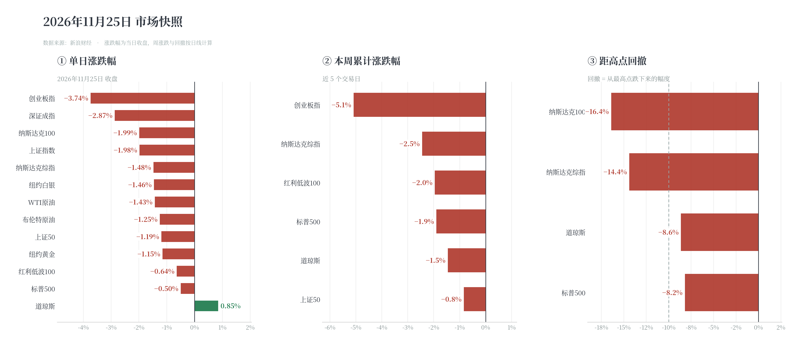

# 每日投资学习材料 · 第 5 期

**2026-11-25（周三）｜主题：当“AI 硬件链”集体回调时，学会分清“价格在跌”和“逻辑在变”**

> 你的关注清单：纳指 · 标普500 · 美股科技/AI · 红利低波100 · 黄金 ｜ 渠道：支付宝场外基金
> 阅读时间约 15 分钟

## 一、今天的行情快照

**三句话总结今天：**
1. 美股最近一个交易日是“指数分化”的一天：纳斯达克综指跌 1.48%、纳斯达克100 跌 1.99%，标普500 只跌 0.50%，而道琼斯反而涨 0.85%——科技权重越高的指数，今天跌得越多。
2. 避险资产今天没有“避险”：纽约黄金跌 1.15%，现货黄金盘中失守 3520 美元/盎司（快讯 14:00），说明资金不是在“逃向黄金”，而是在整体收缩风险敞口。
3. A 股同步走弱且更剧烈：创业板指单日 -3.74%、本周 -5.09%，红利低波100 只跌 0.64%——同一片下跌里，“高波动”和“低波动”的差距被清楚地摆在了台面上。

> **一句话记住今天**：跌的时候，先看“谁跌得少”，那往往就是你组合里的减震器。

## 二、今日价格表

**美股（最近一个交易日收盘）**

| 指数 | 收盘 | 单日 | 本周 | 距52周高点 |
|---|---|---|---|---|
| 纳斯达克综指 | 23,733.54 | -1.48% | -2.45% | -14.39% |
| 纳斯达克100 | 26,214.17 | -1.99% | — | -16.41% |
| 标普500 | 7,201.09 | -0.50% | -1.90% | -8.20% |
| 道琼斯 | 50,018.70 | 0.85% | -1.46% | -8.63% |

**贵金属与商品**

| 品种 | 最新 | 单日 | 本周 | 距高点 |
|---|---|---|---|---|
| 纽约黄金 | 3,549.72 | -1.15% | — | — |
| 纽约白银 | 40.65 | -1.46% | — | — |
| WTI原油 | 80.88 | -1.43% | — | — |
| 布伦特原油 | 87.67 | -1.25% | — | — |

**A股与红利低波100**

| 指数 | 收盘 | 单日 | 本周 |
|---|---|---|---|
| 上证指数 | 3,478.21 | -1.98% | — |
| 深证成指 | 10,124.02 | -2.87% | — |
| 创业板指 | 2,193.86 | -3.74% | -5.09% |
| 上证50 | 2,741.45 | -1.19% | -0.84% |
| 红利低波100（930955） | 11,718.24 | -0.64% | -1.96% |

## 三、今天必须搞懂的一个概念

**概念：指数加权方式——“谁在里面占的份量大，谁就决定指数的脸色”**

今天最扎眼的现象是：道琼斯涨 0.85%，纳斯达克100 跌 1.99%。同一天、同一个市场，为什么方向相反？

因为指数不是“把所有股票平均一下”，而是按规则加权。**加权（weighting）** 的意思是：每只股票对指数涨跌的“话语权”不一样。纳斯达克100 里科技巨头权重极高，科技股一回调，指数就被拖下去；道琼斯用的是另一种加权规则，对高价股、传统行业的话语权更大，所以今天它反而收红。

传导链条是这样的：
科技/AI 硬件链回调（快讯里提到“隔夜英伟达跌近6%、AI硬件链回调”）→ 权重大的科技股拖累 → 纳指100 跌 1.99% → 但同样的下跌，在权重结构不同的道琼斯上被“稀释”甚至被其他成分股抵消 → 于是出现“一涨一跌”。

**直白解释**：指数就像一桌人投票，胖子（权重大）举手就算数，瘦子（权重小）举手基本不影响结果。所以你买“纳斯达克100 基金”，本质上买的是“那几家最大科技公司的表现”，不是“美国科技行业的平均表现”。

这也直接回答了一个新手常问的问题：为什么我买的纳指基金跌得比标普500 基金狠？不是基金经理不努力，是这两个指数里“胖子”的构成不一样。

## 四、术语小词典

| 术语 | 大白话解释 | 今天为什么重要 |
|---|---|---|
| 加权（权重） | 每只股票对指数涨跌的“话语权”大小 | 解释今天道指涨、纳指100 跌的关键 |
| 距52周高点 | 现在价格离过去一年最高点还差多少 | 纳指100 距高点 -16.41%，说明已从高位回落一段 |
| 回撤 | 从高点往下掉的幅度 | 判断“现在是高位还是低位区间”的粗略尺子 |
| 风险敞口 | 你暴露在某种风险下的钱有多少 | 今天黄金也跌，说明“避险”不等于“不亏” |
| 避险资产 | 市场恐慌时大家习惯去买的东西（如黄金） | 今天黄金跌 1.15%，避险资产也会跌，别神化它 |
| 低波动 | 价格起伏相对平缓的品种 | 红利低波100 今天只跌 0.64%，是组合减震器 |
| 红利 | 公司分给股东的现金分红 | 红利低波100 的“红利”二字就来自这里 |
| 场外基金 | 在支付宝等平台按“净值”申赎、不实时竞价的基金 | 你的唯一渠道，决定了你只能按当日收盘净值成交 |
| 净值 | 基金每份值多少钱，通常一天更新一次 | 你今天看到的涨跌，不会立刻体现在净值上 |
| 震荡修复 | 价格在区间内反复、慢慢往回走，不是直线上涨 | 中金研报用词（快讯 13:39），提醒别期待一根直线 |

## 五、新闻与政策解读

**1）快讯 14:04｜港股脑机接口概念回落，脑动极光跌近15%，联想集团跌9.54%；消息面提到“今日随隔夜英伟达跌近6%、AI硬件链回调退潮”。**
教学点：这条快讯把“英伟达跌近6%”和“AI 硬件链回调”直接连了起来。它告诉你：AI 是一个**产业链**，上游芯片一打喷嚏，下游概念股就感冒。你持有的美股科技/AI 基金，波动来源往往就是这条链的某一环，而不是“AI 这个宏大叙事”本身。

**2）快讯 14:08｜瑞银《2027年度展望》：预计全球 AI 投资由 2026 年的 1 万亿美元升至 2027 年 1.4 万亿美元，2028 年进一步增至 1.5 万亿美元；并建议分散回报来源增强组合韧性。**
教学点：注意两件事。第一，这是**机构预测**，不是事实，1.4 万亿是“预计”不是“已发生”，不能当成买入理由。第二，它后半句“分散回报来源、增强组合韧性”才是今天最该抄下来的话——正好对应今天纳指跌、红利低波只跌 0.64% 的现实。

**3）快讯 14:13｜沐曦股份彭莉：AI 算力负载从预训练向强化学习和推理迁移，“每度电能产出多少有用的 Token”成为客户衡量经济账的核心依据。**
教学点：这是产业内部视角的变化——衡量标准从“单颗芯片峰值性能”转向“单位电能的产出效率”。对新手的意义不是去判断谁对，而是理解：**AI 的竞争焦点会迁移**，所以“AI 基金”内部的持仓结构也会随时间变化，你买的不是一个静止的东西。

**4）快讯 13:39｜中金公司：A股短期有望震荡修复，近期调整主要受外部冲击影响，稳市措施有助于缓解担忧，中期前景不必悲观。**
教学点：这是一家机构的**观点**，不是承诺。“有望”“不必悲观”都是概率性表述。学习价值在于它的归因方式：先分清“外部冲击”还是“内部基本面”，再谈修复——这个分析顺序比结论本身更值得学。

**5）快讯 13:55｜比特币 ETF 本月净流出 47.1 亿美元，贝莱德 iShares Bitcoin Trust 本月赎回约 40 亿美元，势将创上市以来最大单月流出。**
教学点：这条不在你的关注清单里，但它是今天最好的“情绪温度计”：高风险资产正在被系统性减仓。它和黄金今天也跌 1.15% 是同一件事的两面——**当大家集体降风险时，没有哪个资产能独善其身**。

## 六、市场情绪读数

| 指标 | 读数 | 怎么读 |
|---|---|---|
| 纳斯达克100 单日 | -1.99% | 科技权重指数领跌，风险偏好收缩 |
| 道琼斯单日 | +0.85% | 同一天有资金流向非科技权重，不是全面崩盘 |
| 标普500 单日 | -0.50% | 跌幅居中，说明拖累集中在科技 |
| 创业板指单日 / 本周 | -3.74% / -5.09% | 高波动资产被卖得最狠 |
| 红利低波100 单日 | -0.64% | 低波动品种明显抗跌 |
| 纽约黄金单日 | -1.15% | 避险资产同跌，属“整体降风险”而非“避险行情” |
| 比特币 ETF 月度净流出 | 47.1 亿美元（截至 11/23） | 高风险偏好资金在撤，情绪偏冷 |
| VIX | 未获取 | 今日数据未提供，不做推测 |

## 七、K 线与趋势结构

先看位置，不谈点位预测：

- **纳斯达克100**：距52周高点 -16.41%，本周数据未获取，单日 -1.99%。这是“从高位回落一段、且仍在回落过程中”的位置。
- **纳斯达克综指**：距高点 -14.39%，本周 -2.45%，单日 -1.48%。
- **标普500**：距高点 -8.20%，本周 -1.90%，单日 -0.50%。回撤幅度明显小于纳指100——这就是权重结构差异的长期体现。
- **红利低波100**：单日 -0.64%、本周 -1.96%，距高点数据未获取。它也在跌，但跌幅是今天 A 股相关品种里最小的。
- **黄金**：纽约黄金 3,549.72，单日 -1.15%；现货盘中失守 3520 美元/盎司（快讯 14:00）。距高点数据未获取。

**必须建立的一个认知**：均线（比如 60 日均线、200 日均线）是**事后确认工具**，不是预测工具。价格先走，均线后跟。当指数已经跌了 16% 时，任何一条均线“被跌破”都只是把已经发生的事画在图上，它不能告诉你明天涨还是跌。新手最容易犯的错，是把“跌破均线”当成卖出信号、把“站上均线”当成买入信号，结果永远慢半拍。

正确的用法是：均线用来**描述状态**（现在是强势区还是弱势区），而不是**发出指令**。今天的状态描述是：美股科技类处于回撤中段，A 股高波动品种处于快速调整中，低波动品种相对抗跌，黄金从高位回落。仅此而已。

## 八、场外基金实操课

**今天讲：净值滞后——为什么你“看到跌了”却“卖在高点”，以及为什么不该按盘中涨跌做决定**

今天现货黄金盘中跌破 3520（快讯 14:00），A 股创业板盘中一度跌 3.92%（快讯 14:11）。很多新手的第一反应是：赶紧在支付宝上卖掉。

但场外基金有个机制你必须懂：**你申赎的价格是“当日收盘后计算出的净值”，不是你现在看到的那个实时数字。**

传导链条：
你在下午 2 点看到大跌 → 点击赎回 → 基金公司按**当天 15:00 收盘后的净值**给你成交 → 如果尾盘反弹了，你卖在了一个比盘中更好的价格；如果尾盘继续跌，你卖在更差的价格。**你无法用盘中信息锁定成交价。**

更关键的是时间差：QDII 类基金（投美股、黄金的）因为时差和结算，净值公布通常还要再滞后，你今天看到的美股跌幅，可能要到明后天才体现在净值上。所以“看着昨夜美股跌了，今天赶紧卖”这个动作，卖的是**已经反映过或尚未反映**的价格，你并不掌握主动权。

**直白解释**：场外基金不是股票，它没有“现价”，只有“今天收盘算出来的价”。你按盘中情绪操作，等于闭着眼睛下单。

实操结论（教学示例，非建议）：
1. 场外基金适合**按计划定投/按规则调仓**，不适合按盘中涨跌做日内决策。
2. 如果你确实想降低科技类仓位，正确的做法是**提前设定规则**（比如“距高点回撤超过 X% 时，把比例调回目标值”），而不是今天看到跌 2% 临时决定。
3. 记住 15:00 这个时间点：15:00 前提交按当日净值，15:00 后按下一交易日净值。这不是技巧，是规则。

## 九、投资建议（教学示例，非个性化建议）

**你必须自己回答的三个问题：**
1. 我这笔投在纳指/标普/科技AI 的钱，**多久之后会用到**？（1 年内要用的钱，不该放在单日能跌 2% 的品种里）
2. 如果纳指100 从现在再跌 10%，我会**加仓、不动、还是卖出**？现在就想好，别等跌了再想。
3. 我的组合里，**红利低波100 和黄金各占多少**？今天红利低波只跌 0.64%，你有没有足够的“减震仓位”？

**分层参考框架（教学示例，非建议，不构成任何买卖指引）：**

| 层次 | 作用 | 今天的数据参照 | 需要你自己决定的 |
|---|---|---|---|
| 进攻层（纳指/标普/科技AI） | 争取长期成长 | 纳指100 距高点 -16.41%，单日 -1.99% | 占比多少、能否承受再回撤 |
| 减震层（红利低波100） | 降低组合波动 | 单日 -0.64%，本周 -1.96% | 是否足以对冲进攻层波动 |
| 对冲层（黄金） | 分散风险，但今天也跌 1.15% | 纽约金 3,549.72 | 别把它当“保险箱”，它也会亏 |

**这周不要做的事：**
- 不要因为单日 -1.99% 就推翻整个计划（单日波动是常态，不是信号）。
- 不要看着盘中数字在场外基金上做赎回决定（净值滞后，你锁不住价）。
- 不要把机构预测（如瑞银的 1.4 万亿）当成“已经发生的事实”来加仓。
- 不要因为黄金“是避险资产”就认为它不会跌——今天它跌了 1.15%。
- 不要在同一天既卖科技又买科技，那不叫调仓，叫来回交手续费。

## 十、今日作业

1. **算一笔账**：打开你的支付宝持仓，把每个基金按“进攻/减震/对冲”三类归一下，算出三类各占百分比。写下来，不要心算。
2. **做一次“如果”推演**：假设纳指100 再跌 10%，你每个基金分别会怎么做？把答案写在备忘录里，明天不许改。
3. **查一个规则**：找到你持有的任意一只 QDII 基金（投美股或黄金的），看它的净值更新时间是 T+1 还是 T+2，记下来。这决定了你“看到的跌”什么时候才真正发生在你的账户上。

## 十一、明日预告

下一期讲：**“定投的节奏到底该按周还是按月——用今天这种下跌日，算一遍两种节奏的实际差别”**。

## 数据来源

- 结构化行情数据（美股指数、贵金属与商品、A 股指数、红利低波100），抓取时间 2026-11-25 14:18:10
- 新浪财经 7×24 快讯（2026-11-25，原文，未核实）

> **免责声明**：本文为投资知识学习材料，不构成任何投资建议。市场有风险，决策请独立判断。
