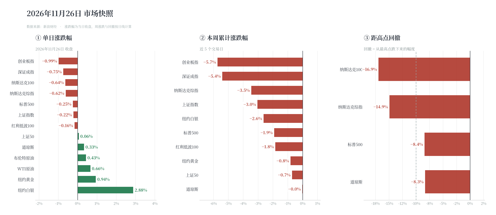

# 每日投资学习材料 · 第 6 期

**2026-11-26（周四）｜主题：当"AI 卖铲人"被出口限制绊了一下，你该看指数还是看新闻？**

> 你的关注清单：纳指 · 标普500 · 美股科技/AI · 红利低波100 · 黄金 ｜ 渠道：支付宝场外基金
> 阅读时间约 15 分钟

## 一、今天的行情快照

**三句话总结今天：**
1. 美股最近一个交易日是"分化"的一天：纳斯达克综指跌 0.62%、标普500 跌 0.25%，但道琼斯反而涨 0.33%——钱没有整体跑掉，是从一部分股票挪到了另一部分股票。
2. 你清单里跌得最深的两个，是纳斯达克100 距 52 周高点 -16.95%、纳斯达克综指 -14.92%；标普500 距高点 -8.44%，回撤只有纳指的一半左右。
3. 黄金单日涨 0.94%，但本周仍是 -0.82%；A 股这边创业板指本周 -5.73%，红利低波100 本周只 -1.84%，同一段时间里"稳"和"猛"的差距很明显。

> **一句话记住今天**：指数跌多少，是"结果"；新闻讲的是"原因"——新手最容易犯的错，是拿原因直接去下单，而不是先看结果有没有超出自己的承受范围。

## 二、今日价格表

**美股（最近一个交易日收盘）**

| 指数 | 收盘 | 单日 | 本周 | 距52周高点 |
|---|---|---|---|---|
| 纳斯达克综指 | 23,585.80 | -0.62% | -3.46% | -14.92% |
| 纳斯达克100 | 26,046.90 | -0.64% | — | -16.95% |
| 标普500 | 7,182.78 | -0.25% | -1.92% | -8.44% |
| 道琼斯 | 50,182.95 | 0.33% | -0.03% | -8.33% |

**贵金属与商品**

| 品种 | 最新 | 单日 | 本周 | 距高点 |
|---|---|---|---|---|
| 纽约黄金 | 3,598.11 | 0.94% | -0.82% | — |
| 纽约白银 | 41.71 | 2.88% | -2.63% | — |
| WTI原油 | 84.23 | 0.66% | — | — |
| 布伦特原油 | 91.03 | 0.43% | — | — |

**A股与红利低波100**

| 指数 | 收盘 | 单日 | 本周 | 距高点 |
|---|---|---|---|---|
| 上证指数 | 3,468.71 | -0.22% | -3.04% | — |
| 深证成指 | 10,010.35 | -0.75% | -5.41% | — |
| 创业板指 | 2,161.96 | -0.99% | -5.73% | — |
| 上证50 | 2,753.51 | 0.06% | -0.72% | — |
| 红利低波100（930955） | 11,703.38 | -0.16% | -1.84% | — |

## 三、今天必须搞懂的一个概念

**概念：指数回撤（drawdown）——为什么"距高点 -16.95%"比"今天跌 0.64%"重要得多**

今天纳指100 单日只跌 0.64%，看起来没什么。但把它和"距 52 周高点 -16.95%"放在一起看，意思完全不同：单日涨跌是**当天的心情**，回撤是**从山顶往下走了多远**。

原理是这样的：假设一个指数从 100 涨到 120（涨 20%），再跌回 100，单日可能只是跌了 1%，但回撤是 -16.7%。**跌得越深，涨回来需要的涨幅越大**——跌 20% 需要涨 25% 才回本，跌 50% 需要涨 100%。这就是回撤的"不对称性"。

传导链条：回撤变大 → 持有人的账面亏损变大 → 容易在低点卖出 → 卖压又加大回撤。所以回撤不只是数字，它会反过来影响人的行为。

**直白解释**：单日涨跌是"今天走了几步"，回撤是"你现在离出发时的最高点有多远"。前者决定心情，后者决定你要不要改计划。

## 四、术语小词典

| 术语 | 大白话解释 | 今天为什么重要 |
|---|---|---|
| 回撤 | 从最高点跌下来的幅度 | 纳指100 距高点 -16.95%，是今天最该盯的数字 |
| 52 周高点 | 过去一年里最贵的那个价格 | 所有"距高点"都是拿它当尺子量的 |
| 分化 | 有的涨有的跌，不是齐涨齐跌 | 今天道指涨、纳指跌，就是典型分化 |
| 场外基金 | 在支付宝这类平台申购、不通过股票账户买卖的基金 | 你唯一的购买渠道，规则和场内不同 |
| 净值 | 基金一份值多少钱，每天收盘后算一次 | 场外基金按"当天收盘净值"成交，你看到的价是滞后的 |
| 调仓 | 机构把手里的股票换成别的股票 | 快讯里说这轮抛售"主要由投资者调仓及市场情绪驱动" |
| 出口限制 | 一国政府规定某些产品不能卖给某些地区 | 今天英伟达暂停向东南亚出货的直接背景 |
| 防御股 | 生意稳定、不太靠经济好坏的股票（如公用事业、必需消费） | 快讯提到有基金提前从 AI 转向防御股 |
| 加息 | 央行提高利率，借钱变贵 | 日本央行官员今天多次谈加息节奏，会影响全球资金流向 |
| 中性利率 | 既不刺激也不抑制经济的利率水平 | 日本央行官员称大约在 2% 左右 |

## 五、新闻与政策解读

**1. 英伟达暂停向东南亚出货芯片**
- 事实：据英国《金融时报》报道，英伟达已通知服务器制造合作伙伴暂停向马来西亚、新加坡、泰国和印度尼西亚发货，涉及戴尔、超微等组装商；报道称英伟达及其合作伙伴正努力遵守美国新的出口限制，禁令是否为暂时性尚不清楚。
- 教学点：**"卖铲人"的生意也会被规则打断**。AI 行情里最赚钱的一环是卖芯片的，但它的收入依赖"能卖到哪儿"。看到这类新闻，第一反应不该是"AI 完了"，而是"这条消息影响的是收入端还是情绪端"——报道本身明确说"是否为暂时性尚不清楚"，这就是不确定性，不是结论。

**2. 普徕仕：AI 基本面扎实，回调择优加仓不追涨**
- 事实：普徕仕分析师李兆坚认为，本周一（23 日）的反弹属于急跌之后的纾缓性反弹，此前抛售主要由投资者调仓及市场情绪驱动；该行坚持审慎选股，计划借调整增持高信心持仓，不盲目追反弹。
- 教学点：注意这家机构的措辞——"借调整增持"和"不追涨"是两件事。**在跌的时候按计划买，和在涨的时候追进去，是完全不同的两种行为**。前者是纪律，后者是情绪。

**3. Jupiter 旗下亚洲基金提早降低 AI 敞口、转向防御股**
- 事实：该基金联席经理表示，在 AI 交易今年夏季开始动摇之前就转向了防御型股票；该基金今年迄今回报接近 25%，过去五年业绩超过所有同类基金。
- 教学点：这是一条"幸存者叙事"——媒体只报道跑赢的那只。**看到"某人提前转向赚到了"，要问：转向没转对的那些人，会不会上新闻？** 答案是基本不会。所以这类新闻可以学思路，不能当信号。

**4. 日本央行官员密集谈加息**
- 事实：日本央行审议委员田村直树表示，设想每隔几个月加息一次、每次 25 个基点，若通胀风险兑现可能加快，甚至一次 50 个基点；预计日本中性利率在 2% 左右；将在 12 月会议上做出适当决定。
- 教学点：日本加息会影响全球资金成本——**借钱变贵，杠杆买资产的人就变少**。这条新闻和你清单里的纳指、黄金都有关联，但关联是"间接的"，不能直接换算成"所以明天该买/该卖"。

**5. 原油连续第三天上涨，中东局势令市场不安**
- 事实：布伦特原油在之前两个交易日上涨近 6%，目前在每桶 95 美元左右交投（注：你提供的行情表显示布伦特最新 91.03，两者口径不同，以表格数据为准）；报道提到胡塞武装继续袭击沙特相关设施、伊朗称数艘船只在霍尔木兹海峡触雷但未获独立证实。
- 教学点：**新闻里的价格和行情表里的价格可能不一致**，因为一个是记者口述的"左右"，一个是收盘报价。新手要以结构化数据为准，新闻只用来理解"为什么动"。

## 六、市场情绪读数

| 指标 | 读数 | 怎么读 |
|---|---|---|
| 纳斯达克综指 本周 | -3.46% | 一周跌超 3%，属于"明显回调"，不是日常波动 |
| 纳斯达克100 距52周高点 | -16.95% | 接近两成的回撤，是"需要认真对待"的级别 |
| 标普500 距52周高点 | -8.44% | 同样回调，但幅度约为纳指一半，说明跌幅集中在科技 |
| 道琼斯 单日 | +0.33% | 大盘价值股逆势收红，是"资金换仓"而非"资金离场"的信号 |
| 黄金 单日 | +0.94% | 避险资产当天走强，与股市分化互相印证 |
| 创业板指 本周 | -5.73% | A 股高波动板块跌幅远大于红利低波100 的 -1.84% |
| VIX（恐慌指数） | 未获取 | 你未提供该数据，本期不做解读 |

## 七、K 线与趋势结构

先看位置，不谈方向：

- **纳斯达克100**：距 52 周高点 -16.95%，本周数据未提供，单日 -0.64%。这是"从高位往下走了接近六分之一"的位置。
- **纳斯达克综指**：距高点 -14.92%，本周 -3.46%。一周跌 3.46%，说明下跌不是一天的事，是持续的。
- **标普500**：距高点 -8.44%，本周 -1.92%。同样是跌，但幅度温和得多——**这就是宽基和科技集中指数的区别**。
- **红利低波100**：本周 -1.84%，单日仅 -0.16%。在 A 股主要指数本周跌 3%~5.7% 的背景下，它跌得最少。
- **黄金**：单日 +0.94%，本周 -0.82%。一周维度几乎没动，属于"高位横住"的状态（距高点数据未获取，不做判断）。

关于均线，必须说清楚一件事：**均线是事后确认工具，不是预测工具**。价格先动，均线后动。所谓"跌破 60 日均线"，意思是"过去 60 天的平均成本已经被跌破了"，它告诉你"这段时间买的人平均在亏"，但不告诉你明天涨还是跌。新手最常见的误用，是把均线当成红绿灯——它更像后视镜。

## 八、场外基金实操课

**今天的知识点：净值滞后——你在支付宝看到的"今天的涨跌"，其实是昨天的事**

这是场外基金最容易被新手误解的一点，而今天的行情正好是绝佳教材。

规则是这样的：场外基金每个交易日只有一个成交价，叫**基金净值**，它在当天收盘后由基金公司计算、通常当晚或次日公布。所以：

- 你在**今天 15:00 之前**提交的申购，按**今天收盘后的净值**成交；
- 你在**今天 15:00 之后**提交的，按**下一个交易日**的净值成交；
- 你**今天白天在 App 上看到的涨跌幅**，反映的是**上一个交易日**的净值变化。

**直白解释**：买场外基金像"寄信"，不是"刷卡"。你按下确认的那一刻，价格还没定；价格要等晚上才算出来。

**这对今天意味着什么？** 假设你看到英伟达暂停出货的新闻，觉得"纳指要跌了，我先卖掉"——你卖掉的价格是"今天美股收盘后"的净值，而美股今天还没开盘（时差），你根本不知道会成交在什么价位。**用新闻做场外基金的高频买卖，本质上是在猜一个你还没看到的价格。**

**给新手的做法**：把场外基金当成"按周/按月决策"的工具，而不是"按新闻决策"的工具。真要动手，记住 15:00 这条线，并且接受"成交价未知"这个事实。另外，同一只基金的 A 类和 C 类，区别主要在收费方式（A 类通常有申购费、适合长期持有；C 类通常按日计提销售服务费、适合短期），具体费率以你支付宝页面上显示的为准，本文不替你判断哪个更划算。

## 九、投资建议（教学示例，非个性化建议）

> **声明：以下全部是教学示例，用于演示"怎么想"，不是给你的操作指令。你的钱、你的风险承受能力、你的用钱时间，只有你自己知道。**

**你必须自己回答的三个问题：**
1. 这笔钱，未来 12 个月内会不会用到？（会用到 → 高波动品种的比例就该低）
2. 如果纳指再跌 10%（也就是回撤扩大到 -25% 左右），我会不会睡不着、想全部卖掉？
3. 我现在的科技/AI 类持仓，占我全部可投资金的比例是多少？（不知道具体数字，就先别加）

**分层参考框架（示例，非建议）**

| 层次 | 作用 | 今天的位置怎么看 |
|---|---|---|
| 宽基（标普500 类） | 打底，波动相对小 | 距高点 -8.44%，回撤温和，是"观察区"不是"恐慌区" |
| 科技/AI（纳指类） | 进攻，波动大 | 距高点 -16.95%，回撤已深，但深不等于到底 |
| 红利低波100 | 压舱，跌得少 | 本周 -1.84%，在 A 股普跌里体现"低波"属性 |
| 黄金 | 分散，和股票不同步 | 单日 +0.94%，本周 -0.82%，起的是"对冲"作用不是"赚钱"作用 |

**这周不要做的事：**
- 不要因为一条"英伟达暂停出货"的新闻就清仓或满仓——报道自己都说"是否为暂时性尚不清楚"。
- 不要看到"某基金提前转向赚了 25%"就照抄——那是幸存者叙事。
- 不要在 15:00 之后下单，还以为自己买的是"今天的价格"。
- 不要用"跌了这么多该反弹了"当买入理由——回撤深只说明跌得多，不说明要涨。
- 不要同时持有三只跟踪同一指数的基金，那不叫分散，叫重复。

## 十、今日作业

1. **算一个数**：打开支付宝，把你持有的所有基金列出来，标出每一只"属于哪一层"（宽基/科技/红利/黄金/其他），算出科技类占你总金额的百分比。写下来，不评价。
2. **查一次净值时间**：随便挑一只你持有的基金，看它的"净值更新日期"是几号，再对比你今天的下单时间，确认你理解了"15:00 前后成交日不同"这条规则。
3. **读一遍原文**：把今天快讯里"普徕仕"那条再读一次，找出它同时说了哪两件相反方向的事（提示：增持 vs 不追涨），用自己的话写一句总结。

## 十一、明日预告

下一期讲：**"宽基 vs 行业指数——为什么标普500 的回撤只有纳指的一半"**，用今天这组 -8.44% 和 -16.95% 的数字，把"分散"这件事算给你看。

## 数据来源

- 结构化行情数据（美股指数、贵金属与商品、A 股指数、红利低波100），由用户提供
- 新浪财经 7×24 快讯（2026-11-26），由用户提供，原文未核实

> **免责声明**：本文为投资知识学习材料，不构成任何投资建议。市场有风险，决策请独立判断。
