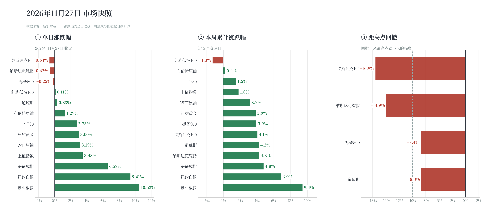

# 每日投资学习材料 · 第 7 期

**2026-11-27（周五）｜主题：同一天里，A股科技暴涨、美股科技回调、黄金大涨——先学会"分开看"，再谈"买什么"**

> 你的关注清单：纳指 · 标普500 · 美股科技/AI · 红利低波100 · 黄金 ｜ 渠道：支付宝场外基金
> 阅读时间约 15 分钟

## 一、今天的行情快照

**三句话总结今天：**
1. 美股上一个交易日是"小回调"：纳斯达克综指 -0.62%、纳斯达克100 -0.64%、标普500 -0.25%，但道琼斯反而是 +0.33%，说明跌的压力集中在科技权重上，不是全面下跌。
2. A股今天走出完全相反的行情：创业板指单日 +10.52%、深证成指 +6.58%、上证指数 +3.48%，快讯里提到"半导体、CPO、先进封装板块涨幅居前，全市场超5300股上涨"。
3. 黄金是今天第二个主角：纽约黄金单日 +3.00%、本周 +3.85%；快讯显示现货黄金盘中连续突破3640、3650、3660美元/盎司。而你清单里的红利低波100，本周是 -1.27%，是唯一本周为负的品种。

> **一句话记住今天**：同一天，三类资产走了三个方向——这不是"市场疯了"，而是提醒你：你清单里的五个品种，本来就不是同一辆车。

## 二、今日价格表

**美股（最近一个交易日收盘）**

| 指数 | 收盘 | 单日 | 本周 | 距52周高点 |
|---|---|---|---|---|
| 纳斯达克综指 | 23,585.80 | -0.62% | +4.28% | -14.92% |
| 纳斯达克100 | 26,046.90 | -0.64% | +4.07% | -16.95% |
| 标普500 | 7,182.78 | -0.25% | +3.94% | -8.44% |
| 道琼斯 | 50,182.95 | +0.33% | +4.23% | -8.33% |

**贵金属与商品**

| 品种 | 最新 | 单日 | 本周 | 距高点 |
|---|---|---|---|---|
| 纽约黄金 | 3,671.42 | +3.00% | +3.85% | — |
| 纽约白银 | 44.35 | +9.41% | +6.87% | — |
| WTI原油 | 86.32 | +3.15% | +3.18% | — |
| 布伦特原油 | 92.85 | +1.29% | +0.24% | — |

**A股与红利低波100**

| 指数/品种 | 收盘 | 单日 | 本周 | 距高点 |
|---|---|---|---|---|
| 上证指数 | 3,597.77 | +3.48% | +1.81% | — |
| 深证成指 | 10,747.19 | +6.58% | +4.79% | — |
| 创业板指 | 2,420.14 | +10.52% | +9.40% | — |
| 上证50 | 2,828.94 | +2.73% | +1.54% | — |
| 红利低波100（930955） | 11,727.43 | +0.11% | -1.27% | — |

## 三、今天必须搞懂的一个概念

**概念：资产之间的"不同步"（低相关性）**

今天最值得学的不是谁涨了多少，而是"它们没有一起涨、也没有一起跌"。

原理：不同资产的价格由不同的钱推动。美股科技股看的是全球资金对AI盈利的预期；A股科技今天看的是国内资金和情绪（快讯里提到股票型ETF净申购超8000亿元、"国家队"稳市表态）；黄金看的是避险和货币信用。三拨钱、三套逻辑，所以经常各走各的。

传导链条（今天可以这样读）：
美股科技回调（纳指100 -0.64%）→ 通常会给A股科技情绪带来压力 → 但今天A股科技反而暴涨（创业板指 +10.52%）→ 说明今天A股的推动力来自国内（ETF放量、"国家队"表态），压过了外部压力 → 同时黄金 +3.00%，说明有一部分钱在同时买"进攻"和"保险"。

**直白解释**：不要把五个品种当成一个东西。它们不同步，才是你把钱分开放的理由；如果它们永远一起涨一起跌，分散就没意义了。

注意一个边界：不同步≠永远对冲。今天A股科技和黄金同时大涨，说明"分散"不是每天都灵，它灵在长期少犯大错。

## 四、术语小词典

| 术语 | 大白话解释 | 今天为什么重要 |
|---|---|---|
| 单日涨跌幅 | 今天收盘比昨天收盘涨/跌了多少 | 今天A股和美股方向完全相反，先看单日再看本周 |
| 本周涨跌幅 | 这一周累计涨/跌多少 | 纳指本周 +4.28% 但单日 -0.62%，只看单日会误判 |
| 距52周高点 | 现在比过去一年最高点低多少 | 纳指100 距高点 -16.95%，标普500 只有 -8.44%，回撤深度不同 |
| 回撤 | 从高点往下掉的幅度 | 同样是美股，纳指100和标普500的回撤差了一倍 |
| 宽基ETF | 跟踪一整个大指数的基金，不是挑几只股票 | 快讯提到沪深300ETF、上证50ETF净申购4000亿元 |
| 净申购 | 买进ETF的钱减掉卖出的钱，是正数 | 快讯说股票型ETF净申购超8000亿元，是"钱在进"的信号 |
| 滚动市盈率 | 股价除以过去12个月每股盈利，衡量"贵不贵" | 快讯称创业板指25倍、纳指28倍，这是原文数据，不是我的判断 |
| 场外基金 | 在支付宝等平台申购、按当日净值成交的基金 | 你只能买这类，所以"净值滞后"必须懂（见第八节） |
| 限购 | 基金公司限制每天最多买多少 | 黄金、科技类基金在资金涌入时常限购，今天这种行情要留意 |
| 国家队 | 官方资金入市稳市的通俗说法 | 快讯提到国常会"加力发挥国家队稳市作用" |

## 五、新闻与政策解读

**1. [11-27 13:52] A股科技股业绩有望延续高增长态势；创业板指滚动市盈率降至25倍，低于美股纳指28倍；创业板ETF、科创50ETF净申购均超1000亿元，"越跌越买"。**
教学点：这条同时给了"估值"和"资金"两个信息。注意两件事：一是"有望"是媒体转述的市场观点，不是事实；二是"越跌越买"描述的是过去一段时间的行为，不代表未来还会这样。学的是"怎么读一条带观点的快讯"，不是照着买。

**2. [11-27 13:46] 国常会首次提到加力发挥"国家队"稳市作用；10月初以来股票型ETF净申购超8000亿元，总规模增至2.9万亿元。**
教学点：政策表态和资金数据是两回事。表态是"可能还会流入"（原文用词），资金数据是已经发生的。做判断时，把"已发生"和"可能发生"分开记，这是新手最容易混的地方。

**3. [11-27 13:42] 宽基ETF放天量，较昨日此时放量超2倍；沪深300ETF华泰柏瑞等较昨日放量超3倍。**
教学点："放量"指成交金额明显放大。放量说明分歧大——有人大量买、也有人大量卖，只是今天买的一方赢了。放量本身不是买入信号。

**4. [11-27 13:46] 港股贵金属概念午后走强，灵宝黄金涨超12%，中国白银集团涨10%。**
教学点：黄金上涨会传导到黄金股，但黄金股≠黄金。金价是商品价格，金矿股还叠加了公司经营、股市情绪，波动通常更大。你清单里的是黄金，不是黄金股，别混。

**5. [11-27 13:12] 印度将白银关税从每公斤1496美元下调至1293美元。**
教学点：今天白银单日 +9.41%，波动远大于黄金 +3.00%。这类商品新闻会影响短期价格，但对你"长期配置"的意义有限——先分清"新闻驱动"和"配置逻辑"。

## 六、市场情绪读数

| 指标 | 读数 | 怎么读 |
|---|---|---|
| 创业板指单日 | +10.52% | 单日两位数是极端情绪，不是常态，别把它当基准 |
| 创业板指本周 | +9.40% | 一周涨近一成，短期涨幅已经很大 |
| 全市场上涨家数 | 超5300股上涨（快讯原文） | 普涨，说明是情绪面驱动的全面行情 |
| 宽基ETF成交量 | 较昨日此时放量超2倍（快讯原文） | 分歧放大，不是单边一致 |
| 纽约黄金单日 | +3.00% | 黄金单日3%属于明显异动，通常伴随避险或货币因素 |
| 纽约白银单日 | +9.41% | 比黄金更极端，属于高波动品种 |
| VIX（恐慌指数） | 未获取 | 今天没有这项数据，不做推断 |

## 七、K线与趋势结构

先明确一件事：**均线、趋势线都是事后确认工具**。它们是把已经走出来的价格画成一条线，帮你描述"过去发生了什么"，不是预测"接下来会怎样"。新手最常见的错误，是把均线当成红绿灯。

按你手上的数据，能说的只有位置，不能说方向：

- **纳斯达克100**：距52周高点 -16.95%，本周 +4.07%。位置是"从高点回落较深、本周在修复"。修复能走多远，数据里没有答案。
- **标普500**：距高点 -8.44%，本周 +3.94%。同样在修复，但回撤比纳指100浅一半——这说明这轮下跌里，科技权重是主要拖累。
- **红利低波100**：本周 -1.27%，是清单里唯一本周为负的。今天A股科技暴涨，它只 +0.11%。这不是它"坏了"，而是它的性格：涨得慢、跌得也慢，在情绪亢奋的日子里必然跑输。
- **黄金**：本周 +3.85%，今天 +3.00%，处在明显上行的一段里。但"距高点"这一栏数据未提供，所以我不给"是否创新高"的结论。

一句话：**今天的位置信息足够你判断"谁贵谁便宜、谁跌得深"，但不足以判断"明天谁涨"。** 前者可以用来做配置比例，后者不该用来做交易。

## 八、场外基金实操课

**今天讲：净值滞后 + 限购，这两个是场外基金最容易被新手忽略的坑。**

**净值滞后**：场外基金不是实时成交，你今天下午3点前提交的申购，按**今天收盘后算出的净值**成交；3点后提交，按下一个交易日的净值。这意味着：

- 你今天看到A股科技暴涨 +10.52%，现在去申购科技类基金，买入价大概率已经包含这波涨幅，不是"抄到了起点"。
- 反过来，美股昨夜跌了，你今天买纳指类QDII基金，成交价对应的也是"已经跌过"的净值，不是"跌之前的价"。

**直白解释**：场外基金是"按收盘价结账的商店"，不是"随时按现价成交的交易所"。你看到的价格，永远比你下单的价格旧一点。

**限购**：当某类基金资金涌入过快，基金公司会设每日申购上限（比如每天最多买1000元）。今天这种黄金、A股科技同时被追捧的日子，是最容易遇到限购的时候。遇到限购怎么办：不要为了"绕过限购"去开多个账户或拆分申购，那是在跟规则较劲；正确做法是把定投金额调小、拉长周期，或者接受"这个月就买这么多"。

**给你的具体动作**：今天不要因为看到 +10.52% 就临时加大申购。如果你有定投计划，按原计划执行；如果没有计划，先写下"我打算每月投多少、投哪几个品种、各占多少"，下周再动手。

## 九、投资建议（教学示例，非个性化建议）

> **声明：以下是教学示例，用于演示思考框架，不是给你的个性化建议。你的资金、收入、风险承受能力我不知道，任何比例都必须你自己定。**

**你必须自己回答的三个问题：**
1. 这笔钱多久不用？（3年内要用的钱，不该放进波动大的品种）
2. 如果明天你买的品种跌20%，你会加仓、拿着不动，还是卖出？（答案决定你该配多少）
3. 你清单里五个品种，你打算各占多少？写下来，今天不写，明天行情一变你就没有标准了。

**分层参考框架（示例，非建议）**

| 层次 | 可以放什么 | 这一层的作用 | 今天的数据提示 |
|---|---|---|---|
| 压舱层 | 红利低波100、宽基类 | 波动小、拿得住 | 本周 -1.27%，今天只 +0.11%，慢是它的特征 |
| 成长层 | 纳指/标普500/美股科技 | 长期增长来源，但回撤深 | 纳指100距高点 -16.95%，波动要提前接受 |
| 保险层 | 黄金 | 与股票不同步，起缓冲作用 | 今天 +3.00%，短期已明显上涨，别追高 |
| 现金层 | 货币基金等 | 留出加仓和应急的子弹 | 今天无相关数据 |

**这周不要做的事：**
- 不要因为创业板指单日 +10.52% 就一次性大额买入科技类基金。
- 不要因为黄金今天 +3.00% 就把黄金比例临时调高——它本周已 +3.85%。
- 不要用"越跌越买"这句快讯当理由，去接一个你还没搞懂逻辑的品种。
- 不要在场外基金上做"今天买明天卖"，净值滞后+申赎费会让短线几乎无利可图。
- 不要看单日涨跌就改定投计划，至少看一周。

## 十、今日作业

1. **写下来**：用一张纸或备忘录，写下你五个关注品种的目标比例（合计100%），并给每个写一句"我为什么买它"。今天不写，以后每次波动你都会被情绪牵着走。
2. **查一次限购**：打开支付宝，查你关注的黄金类和纳指类基金，看有没有"单日限购XX元"的提示，记下来。这是你今天能亲手验证的知识点。
3. **读一条快讯，标出"事实"和"观点"**：拿第5节第1条（创业板指25倍PE那条），把句子分成"已发生的事实"和"某方的看法"两类。练这个，比记点位有用得多。

## 十一、明日预告

下一期讲：**"距离52周高点"这一栏，怎么用来判断该不该加仓——以及为什么它不能单独用。**

## 数据来源

- 结构化行情数据（美股指数、贵金属与商品、A股指数、红利低波100），由你提供
- 新浪财经 7×24 快讯（2026-11-27，原文，未核实）
- 其余未在以上两项中出现的数字，本文一律标注"未获取"

> **免责声明**：本文为投资知识学习材料，不构成任何投资建议。市场有风险，决策请独立判断。
