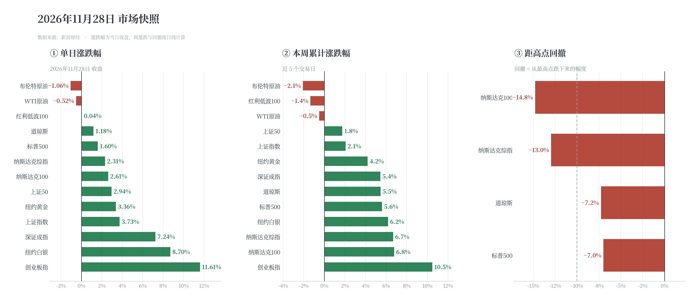

# 每日投资学习材料 · 第 8 期

**2026-11-28（周六）｜主题：一周普涨之后，学会看"涨的是谁、跌的是谁"——从本周分化里理解"风格"**

> 你的关注清单：纳指 · 标普500 · 美股科技/AI · 红利低波100 · 黄金 ｜ 渠道：支付宝场外基金
> 阅读时间约 15 分钟

## 一、今天的行情快照

**三句话总结今天：**
1. 本周是普涨周：纳指周涨 6.68%、标普500 周涨 5.60%，快讯原文称标普500创下 2025 年 4 月以来最大单周涨幅、纳指创下 2026 年 4 月以来最大单周涨幅。
2. 但普涨里也有掉队的：红利低波100 本周 -1.35%，是关注清单里唯一收跌的品种——这就是"风格"在起作用。
3. 黄金本周 4.21%、白银 6.18%，快讯原文提到金价"从15个月低点强劲反弹"，同时明确提示"断言市场触底为时尚早"。

> **一句话记住今天**：一周里所有东西都涨，不代表你买的东西都会涨；先分清"涨的是哪一类资产"，再谈要不要动手。

## 二、今日价格表

**美股（最近一个交易日收盘）**

| 指数 | 收盘 | 单日 | 本周 | 距52周高点 |
|---|---|---|---|---|
| 纳斯达克综指 | 24,129.50 | 2.31% | 6.68% | -12.96% |
| 纳斯达克100 | 26,726.39 | 2.61% | 6.78% | -14.78% |
| 标普500 | 7,297.49 | 1.60% | 5.60% | -6.97% |
| 道琼斯 | 50,774.94 | 1.18% | 5.46% | -7.25% |

**贵金属与商品**

| 品种 | 最新 | 单日 | 本周 | 距高点 |
|---|---|---|---|---|
| 纽约黄金 | 3,684.27 | 3.36% | 4.21% | — |
| 纽约白银 | 44.06 | 8.70% | 6.18% | — |
| WTI原油 | 83.25 | -0.52% | -0.49% | — |
| 布伦特原油 | 90.70 | -1.06% | -2.08% | — |

**A股与红利低波100**

| 指数 | 收盘 | 单日 | 本周 |
|---|---|---|---|
| 上证指数 | 3,606.49 | 3.73% | 2.06% |
| 深证成指 | 10,814.02 | 7.24% | 5.44% |
| 创业板指 | 2,443.96 | 11.61% | 10.48% |
| 上证50 | 2,834.68 | 2.94% | 1.75% |
| 红利低波100（930955） | 11,718.46 | 0.04% | -1.35% |

## 三、今天必须搞懂的一个概念

**概念：风格分化（成长 vs 红利）**

本周数据摆在一起看非常典型：创业板指周涨 10.48%、纳斯达克100 周涨 6.78%，而红利低波100 周跌 1.35%。同一周、同一个市场环境，两类资产方向相反。

原理：市场上资金的总量在短期内变化不大，钱往"进攻型"资产跑的时候，往往是从"防守型"资产里挪出来的。成长类资产（科技、创业板）靠的是"未来盈利会更快增长"的预期，情绪一转好就涨得猛；红利低波类资产靠的是"当下稳定分红、波动小"，它的吸引力恰恰在市场恐慌、利率下行时最突出。所以它经常不是"涨得慢"，而是"在别人涨的时候被卖出"。

传导链条：情绪改善 → 资金从防守位撤出 → 成长板块获得增量买入 → 成长指数大涨 → 红利类指数因资金流出而小幅下跌。

**直白解释**：风格就像球队里的前锋和后卫。球队赢球时大家只夸前锋进球多，但后卫本来就不是用来进球的——你不能因为后卫这周没进球，就说买错了人。关键是你的组合里，前锋和后卫各占多少。

## 四、术语小词典

| 术语 | 大白话解释 | 今天为什么重要 |
|---|---|---|
| 单日涨跌幅 | 最近一个交易日比前一天涨了或跌了多少 | 表里"单日"那一列，反映的是最后一天的力度 |
| 周涨跌幅 | 这一周整体涨了或跌了多少 | 今天复盘的核心，看一周而不是看一天 |
| 距52周高点 | 现在离过去一年最高点还差多少（负数=还在下方） | 纳指100 距高点 -14.78%，说明涨了一周也还没回到高位 |
| 风格 | 一类资产的"性格"：进攻型还是防守型 | 本周成长大涨、红利下跌，就是风格分化 |
| 红利低波 | 分红较高、价格波动较小的股票组合 | 它是你清单里的"后卫"，本周 -1.35% |
| 超卖 | 跌得太急太多，短期卖压可能衰竭 | 快讯说黄金进入超卖区域，但同时说这不是买入信号 |
| V形反转 | 先急跌、再急涨，走势像个 V 字 | 快讯原文用这个词描述本周金价 |
| 算力订单 | 公司签下的提供计算能力的合同 | 快讯提到月内10余家上市公司披露算力订单 |
| 加息概率 | 市场用利率期货推算出的、对央行加息的押注比例 | 快讯称12月加息25个基点概率98.9% |
| 场外基金 | 在支付宝这类平台申购、不通过股票账户买卖的基金 | 这是你唯一的购买渠道 |

## 五、新闻与政策解读

**1）全球股市情绪改善，金银大涨；分析认为黄金进入超卖区域，但"断言市场触底为时尚早"（央视财经）**
教学点：注意这条新闻里的两层意思——第一层是事实（金银大涨），第二层是观点（超卖≠买入信号）。新手最容易把"专家说超卖"直接翻译成"该买了"。原文明确写了"市场超卖时间可能比投资者预期的要长"，这句话才是重点：超卖可以持续很久。

**2）本周标普500涨5.6%、道指涨5.5%、纳指涨6.7%；标普500创2025年4月以来最大单周涨幅，纳指创2026年4月以来最大单周涨幅**
教学点：这是本周复盘最硬的一条事实。"最大单周涨幅"是描述过去，不是预测未来。看到这类表述，正确反应是"这周涨得很多"，而不是"下周还会涨"。

**3）模型推理等环节需求提升，月内10余家上市公司披露算力订单**
教学点：这条给"美股科技/AI"的关注提供了一个产业链视角——需求从"训练"往"推理"延伸。对新手来说，值得记住的是：AI 不只是几家大公司，它是一条从算力到应用的链条，不同环节的景气度不同步。

**4）美联储12月加息25个基点的概率为98.9%（CME"美联储观察"）**
教学点：这是市场押注，不是官方决定。它影响的是全球资金的"无风险收益率"参照。注意方向：这里说的是"加息"，不是降息——加息环境下，靠分红吸引人的红利类资产和靠远期盈利的成长类资产，受压方式不一样。

**5）外资机构展望2027年中国股市，关注盈利改善与估值修复，行业上关注国产算力、半导体，以及银行、互联网、医药及出海企业**
教学点：机构观点属于"未核实的第三方看法"，只能当参考信息，不能当依据。但它提示了一件事：机构同时在看"算力"和"银行"——也就是同时在看进攻和防守，这正好呼应今天的风格主题。

## 六、市场情绪读数

| 指标 | 读数 | 怎么读 |
|---|---|---|
| 纳指100 单日 | +2.61% | 最后一天涨幅大于周涨幅的一半，说明涨势集中在后半段 |
| 标普500 本周 | +5.60% | 快讯原文称创2025年4月以来最大单周涨幅，情绪明显改善 |
| 纽约白银 单日 | +8.70% | 单日涨幅远超黄金，贵金属内部也在"加杠杆式"追涨 |
| 红利低波100 本周 | -1.35% | 防守型资产被冷落，是风险偏好回升的侧面证据 |
| 12月加息概率 | 98.9% | 市场高度一致地押注加息，一致性过高本身值得留意 |
| VIX | 未获取 | 本期数据源未提供，不做推测 |

## 七、K线与趋势结构

把三组数字放在一起看趋势位置：

- **美股**：纳指100 距52周高点 -14.78%，标普500 距高点 -6.97%。意思是：本周虽然大涨 6% 以上，但纳指100 仍在一年高点的下方约七分之一处。这属于"深跌之后的反弹"，不是"创新高的上涨"。
- **黄金**：快讯原文说本周"整体呈现出V形反转行情"，11月25日美股早盘曾跌至 3426.77 美元，周五收在 3653.53 美元（现货）。V形反转是事后画出来的形状，跌的那天没人知道那是底。
- **红利低波100**：本周 -1.35%，与成长方向相反，处在被资金冷落的位置。

**必须建立的认知**：均线、趋势线这类工具，本质是"事后确认"——它告诉你趋势已经形成了，而不是趋势将要形成。本周纳指涨 6.68%，均线当然会跟着往上走，但那是结果，不是原因。新手最常见的错误，是把"价格站上均线"当成买入信号，而忽略了它同时也可能是"已经涨完一段"的标志。

## 八、场外基金实操课

**本期讲透：净值滞后（为什么你周一看到的涨跌，不是周一的事）**

场景：本周纳指100 涨 6.78%，你想在支付宝上买一只跟踪纳斯达克的场外基金。这里有个必须知道的时间差。

场外基金的"净值"，是基金公司每天收盘后根据持仓算出来的，通常晚上才更新。而跟踪美股的 QDII 基金更特殊：美股在北京时间的夜里交易，所以你在支付宝上看到的"最新净值"，往往是**前一个美股交易日**的结果。你今天下午三点前下单，成交价用的也是当天晚上才出来的那个净值——你下单时并不知道自己买在了什么价格。

三个直接后果：
1. **你无法"看到涨了再买"**。等你看到大涨的净值，那已经是过去的事了。
2. **大涨当天申购，可能买在短期高点**。这不是说一定跌，而是说你的买入价里已经包含了那天的涨幅。
3. **赎回到账也慢**。QDII 基金涉及跨境结算，到账时间通常比境内基金长（具体天数以支付宝页面显示为准，本期数据未提供）。

**给你的做法**：既然价格不可预知，就别用"猜今天涨跌"的方式下单。把买入拆成固定金额、固定间隔（比如每周或每两周一次），让价格自己平均掉。这不是提高收益的技巧，是降低"买在最高点"这种单次错误的概率。

## 九、投资建议（教学示例，非个性化建议）

**你必须自己回答的三个问题：**
1. 我这笔钱，多久之内不会用到？（少于1年的钱，不适合放进波动大的品种）
2. 我清单里的五个方向，各自占多少比例？写下来了吗？
3. 如果明天纳指跌 10%，我是加、是等、还是卖？现在就想好，别到时候想。

**分层参考框架（教学示例，非个性化建议）**

| 层次 | 作用 | 对应你清单里的方向 | 本周表现给它的提示 |
|---|---|---|---|
| 进攻层 | 争取增长，接受大波动 | 纳指、标普500、美股科技/AI | 本周大涨，但距高点仍分别 -12.96%/-6.97%/-14.78%（纳指100），说明波动是常态 |
| 防守层 | 降低整体波动 | 红利低波100 | 本周 -1.35%，在普涨周里拖后腿，这正是它"防守"的代价 |
| 分散层 | 与股票相关性较低 | 黄金 | 本周 +4.21%，但快讯明确提示"断言触底为时尚早" |

**这周不要做的事：**
- 不要因为"标普创最大单周涨幅"就加大投入——这是对过去的描述，不是对未来的承诺。
- 不要因为红利低波本周跌了 1.35% 就判定它"不行"——一周的表现说明不了风格的好坏。
- 不要因为快讯说黄金"超卖"就一次性重仓——原文自己说了超卖可能持续更久。
- 不要在同一天把五个方向全部买入后就不管了——先写下比例，再执行。
- 不要用"下周会怎样"来决定今天买多少。

## 十、今日作业

1. **做一张自己的表**：把上面第二部分的三个表格抄一遍（手写或打字都行），然后在红利低波100 那一行旁边写一句"它本周跌，是因为____"。写不出来就回看第三部分。
2. **查一次真实净值**：打开支付宝，找到你关注的任意一只跟踪纳斯达克或标普500的场外基金，看它的"净值日期"是哪一天，和你以为的"今天"差几天。把天数记下来。
3. **写下一句话**：用不超过 30 个字，写下你对"风格"的理解。下周回看时，看这句话还成不成立。

## 十一、明日预告

下一期讲：**"定投日撞上大涨周，该不该推迟扣款？"**——从本周的普涨行情出发，拆解定投节奏里最常见的三个心理陷阱。

## 数据来源

- 结构化行情数据（美股指数、贵金属与商品、A股指数、红利低波100）：本期提供的 JSON 行情表
- 新闻快讯：新浪财经 7×24（原文标注来源含央视财经、经济日报等），未核实
- 缺失项：VIX、汇率、利率具体数值、QDII 赎回到账天数——本期未提供，均标注"未获取"

> **免责声明**：本文为投资知识学习材料，不构成任何投资建议。市场有风险，决策请独立判断。
